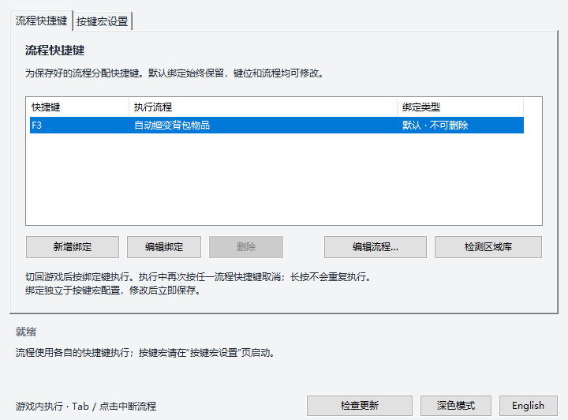

# d4box

暗黑 IV 的 Windows 辅助工具。在一个主程序里配置按键宏、物品处理流程、流程快捷键和可复用的画面检测，无需独立编辑器。

**[下载主程序](https://github.com/liuapart/d4box/releases) · [安装指引](docs/guide/installation.md) · [图文使用手册](docs/guide/README.md) · [常见问题](docs/guide/troubleshooting.md)**



> 截图基于 v0.3.1。手册中的配置用于说明界面；游戏坐标和检测条件需要在自己的机器上采集、测试。

## 可以做什么

- **按键宏**：四套可命名配置，技能键与左右键策略，间隔、延迟和自定义启停键。
- **物品流程**：单个鼠标指向物品或扫描背包，编辑选择、执行、等待和结果检测步骤。
- **可选确认**：检测到绑定确认框后才点击接受，没出现则跳过。
- **检测区域库**：截图框选、命名、出现／关闭双向测试，多个流程复用同一个检测节点。
- **多流程快捷键**：默认 F3 可改键、改流程，另加其他按键执行不同流程。
- **便携运行与更新提示**：独立 Windows x64 EXE，主程序显示版本并可查询稳定版更新。

血球检测、辅助喝药等原有辅助功能已裁剪。自动操作依赖前台游戏窗口、坐标标定和画面检测；内置旧流程也需要在实际布局下验证。

## 下载安装

1. 打开 [Releases](https://github.com/liuapart/d4box/releases)，选择 `d4box-vX.Y.Z` 主程序稳定版。
2. 下载 Assets 中的 Windows x64 ZIP 并解压到固定可写目录，或下载独立 EXE。不要把 `Source code` 当作运行包。
3. 双击 EXE。**无需安装 AutoHotkey、Qt 或 Visual Studio。**
4. 按[快速上手](docs/guide/quick-start.md)配置；首次流程从一个物品开始验证。

完整步骤、文件选择和校验方法见[安装与启动](docs/guide/installation.md)。

## 使用文档

| 指南 | 内容 |
| --- | --- |
| [手册首页](docs/guide/README.md) | 按使用目标选择阅读路径，完整目录与概念说明 |
| [快速上手](docs/guide/quick-start.md) | 页面导航、首次配置、状态与停止 |
| [按键宏](docs/guide/macros.md) | 四套配置、技能策略、时间参数和启停 |
| [物品流程编辑](docs/guide/workflows.md) | 单物品／背包模式、各步骤、坐标、可选接受、结果检测 |
| [检测区域库](docs/guide/detection-regions.md) | 自动截图、框选、双向验证和节点复用 |
| [流程快捷键](docs/guide/hotkeys.md) | 默认绑定、多键多流程、冲突与取消规则 |
| [更新与备份](docs/guide/updates-and-backup.md) | 手动更新、数据位置、迁移和恢复 |
| [故障排查](docs/guide/troubleshooting.md) | 按键无响应、采集和检测失败、显示问题、反馈模板 |

升级前退出程序并备份。替换 EXE 时保留旁边的 `settings.ini` 和整个 `.runtime`；更新检查只提示和打开发布页，不自动替换程序。

## 开发与项目结构

```text
app/ahk/        AHK 入口、界面、执行器、配置与 Windows 测试
scripts/        源码启动、编译、仓库检查与文档截图工具
.github/        AHK 构建与发布 Actions
docs/guide/     Markdown 图文使用手册
docs/           架构、流程技术参考、发布与验证文档
LICENSES/       第三方许可
```

[开发指引](docs/development.md) · [架构](docs/architecture.md) · [构建与发布](docs/ahk-release.md) · [Windows 验证清单](docs/windows-validation.md) · [全部文档](docs/README.md)

主分支只维护 AHK 应用。独立 Qt editor 的源码、设计与脚本保存在标签 `archive/editor-before-ahk-only`（提交 `3ec4e87`），内置流程编辑器和检测区域库继续维护。恢复历史源码见[开发指引](docs/development.md#editor-archive)。

## 来源与反馈

项目基于 [D4KeyHelp](https://github.com/duzefu/D4keyHelp) 源码扩展维护。来源、许可证与打包运行时声明见[第三方声明](THIRD_PARTY_NOTICES.md)和 [LICENSES](LICENSES/)。上游 README 保留在 `docs/upstream/` 作为来源快照，不作为当前版本使用说明。

遇到问题先查[故障排查](docs/guide/troubleshooting.md)，再通过 [Issues](https://github.com/liuapart/d4box/issues) 提供版本、复现步骤和相关截图。
