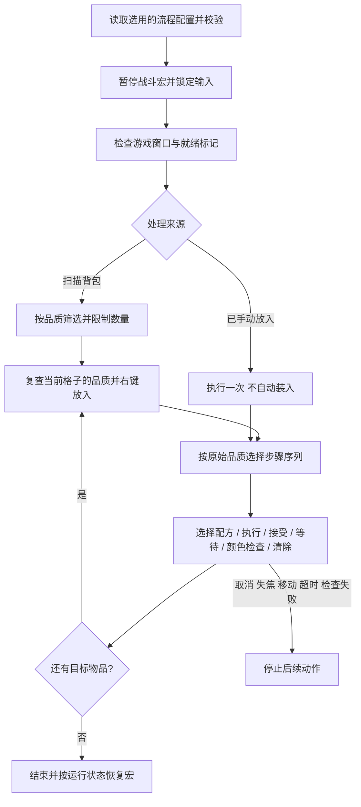

# 魔盒配方：现有逻辑与统一流程

## 原来的嬗变逻辑

原先 `UtilityActions.ahk` 把截图取色、背包遍历、红装动作、黄装动作和运行状态混在一起。F3 进入流程，暂停战斗宏，扫描右下角 11×3 个背包格，按边框颜色筛选物品，逐件执行后恢复宏。

| 输入物品 | 原动作顺序 |
| --- | --- |
| 传奇／暗金色 | 右键放入 → 选择嬗变 → 执行 → 接受 → 清除 |
| 稀有黄装（勾选升级黄装） | 右键放入 → 添加词缀并执行、接受 → 升级传奇并执行、接受 → 嬗变并执行、接受 → 清除 |

原流程没有识别物品词缀、收藏状态或材料数量。它只用颜色粗分品质；运行完点击序列也不代表游戏操作已经成功。

两条路径原有的嬗变按钮纵坐标不同：红装为 `0.380`，黄装升级后为 `0.350`。目前作为两组数据保留，未假设它们可以合并。

## 统一模型



“配方”变成配置数据；执行器只识别通用动作，不再为每个配方新增 `TransmuteXXXItem()` 函数。

模块分工：

| 模块 | 责任 |
| --- | --- |
| `functions/InventoryScanner.ahk` | 截取背包区域、品质筛选、返回格子位置 |
| `functions/CubeProfiles.ahk` | 读取、校验、保存流程，按原始品质生成步骤快照 |
| `functions/CubeRunner.ahk` | 执行步骤，管理输入互斥、取消、窗口检查、超时和颜色等待 |
| `gui/CubeWorkflowGUI.ahk` | 选择、复制和编辑流程，采集位置与颜色，预览顺序 |
| `config/cube-workflows.ini` | 随代码提供的内置“自动嬗变背包物品”配置 |

原有通用截图函数继续留在 `UtilityActions.ahk`，供背包与血球识别共用。

## UI 使用

1. 在主界面点击“配方流程…”。首次默认选用内置“自动嬗变背包物品”。
2. 选择“新建流程”或“复制为新流程”，编辑名称和处理来源。新建默认使用手动放入模式，提供选择、执行、接受、清除四步模板，仍需自己校准和添加检查点。
3. 背包模式选择品质与物品上限；手动模式先自己把材料或物品放进魔盒，流程只执行一次。手动模式的步骤条件必须全部设成“全部／无条件”。
4. 在步骤表中添加、删除、上移、下移，设置动作、原始品质条件、位置和等待时间。编辑行时可点击“更新步骤”；保存或切换行也会收纳当前行的修改。
5. 需要重新定位时，点击“采集鼠标位置与颜色”，在 3 秒内切回游戏，将鼠标放到目标点。采集只读取位置和颜色，不点击。
6. 采集魔盒就绪标记。选择稳定、能代表魔盒已打开的色块；为流程末尾添加“等待颜色匹配”，采集代表流程结束状态的色块。也可在中间步骤插入检查点。
7. “预览执行顺序”只显示计划，不移动鼠标或操作游戏。
8. “保存并选用”，切回游戏的魔盒界面按 F3 执行。再次按 F3 取消。

内置配置只读，通过复制建立自己的版本。“升级黄装”勾选项仅影响内置流程，自定义流程使用自己的品质筛选。

步骤的品质条件使用**开始处理时的原始品质**。因此黄装升级成传奇后，仍会继续执行同一条黄装路径，不会中途跳到红装路径。

## 动作类型

| 动作 | 行为 |
| --- | --- |
| 选择配方、点击执行、点击接受、清除物品 | 点击配置的位置，再等待指定时间；不同名称用于表达业务意图 |
| 等待 | 只等待，不发送输入 |
| 等待颜色匹配 | 等待指定像素颜色达到容差要求，连续两次采样匹配才继续；超时停止 |

接受弹窗不是硬编码必经步骤。其他配方不需要接受时，删除该步骤即可。复杂配方可以增加多个“选择→执行→接受”组合。

自定义流程执行前必须有就绪标记，每条实际会执行的品质路径最后必须是颜色检查，并至少有一个“点击执行”。未配置完整时仍可保存草稿，但 F3 会拒绝运行。颜色检查只验证配置的视觉状态，不代表理解配方或核对装备属性。

内置配置保留旧版行为，未强制新增视觉结果校验；界面会明确标注这一点。若要给它增加检查，复制后编辑。

## 坐标和运行边界

- 内置流程沿用原版主屏全屏比例标定。窗口未铺满主屏时拒绝直接使用它。
- 自定义流程可选择游戏客户区坐标，X/Y 范围为 0～1。改变布局、UI 缩放或宽高比后仍须重新校准，比例坐标不是自动识图。
- 执行中失去游戏焦点、窗口移动或尺寸改变、达到总超时，会停止后续动作。手动点击或按 Tab 也会中断流程并暂停战斗宏。
- 每次放入背包物品前重新检查格子的品质；这不能区分颜色相同的不同物品，也不识别收藏状态。
- 执行期间不重启战斗定时器。F3 取消请求与“执行器已退出”分开管理，连续按 F3 不会让旧流程与新流程重叠。
- 当前不支持 OCR 找配方、自动滚动搜索、自动选棱柱、自动读取材料余额，以及一轮同时自动装入多件材料。需要手动放入的配方可以使用手动模式。

## 保存与扩展

- 内置配置：`app/ahk/config/cube-workflows.ini`，随代码提交。
- 自定义配置和当前选用：`app/ahk/.runtime/cube-workflows.ini`，已被 Git 忽略。
- 配方流程选择是应用级设置，不随四组战斗宏预设切换。旧的“升级黄装”仍沿用原来各预设的配置。
- 自定义保存使用临时文件再替换，删除的步骤不会残留。正在执行时使用流程快照，后续改配置不会改变本次执行。
- 配置仅描述允许的动作，不执行配置中的脚本或任意命令。

内置 INI 使用 ASCII 标识，显示名称来自中英文语言表，避免 Windows INI API 对 UTF-8 中文的编码差异。用户配置由 AHK `IniWrite` 写入。单个步骤记录格式为：

```text
名称|动作|原始品质条件|X|Y|等待毫秒|RGB六位颜色或-|颜色容差|检查超时毫秒
```

后续增加图像定位或滚动搜索，可以在动作类型及输入适配器上扩展，继续复用来源筛选、顺序执行、取消、超时和配置 UI。

## 验证范围

Mac 可执行：

```sh
python3 scripts/check_project.py
python3 -m unittest discover -s scripts/tests -v
bash -n app/ahk/tests/run.sh
```

配置回归核对内置红装／黄装动作顺序、坐标、延时、分支与语言资源。

Windows 还需执行：

```sh
bash app/ahk/tests/run.sh validate
bash app/ahk/tests/run.sh workflow
bash app/ahk/tests/run.sh smoke
```

`workflow` 使用模拟输入适配器，检查规划、配置往返、取消和检查失败，不实际点击游戏。`smoke` 创建主界面与配方编辑器。上述 AHK 测试及真实游戏行为尚未在当前 Mac 环境运行。
