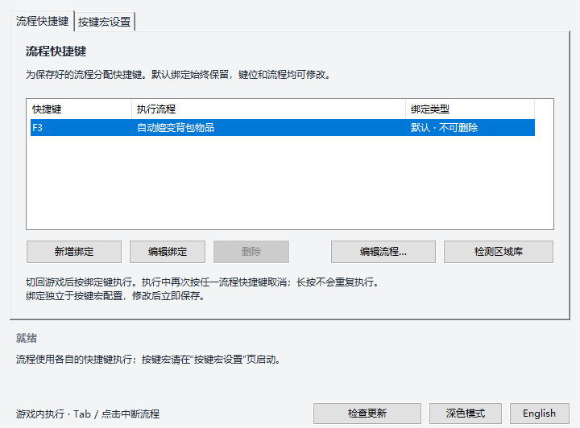

# d4box 使用手册

[项目首页](../../README.md) · [全部文档](../README.md) · [下载发行版](https://github.com/liuapart/d4box/releases)

d4box 把按键宏、物品处理流程、快捷键绑定和画面检测放在同一个 Windows 主程序中。这套手册从下载安装到第一次配置开始，不需要编程经验。

**适用版本：主程序 v0.3.1。** 页面按钮以中文界面为准；英文界面可在主窗口底部切回中文。本文中的“编辑器”均指主程序内的流程编辑窗口。

## 从哪里开始

| 你的目标 | 阅读顺序 |
| --- | --- |
| 第一次使用 | [安装](installation.md) → [快速上手](quick-start.md) |
| 自动按技能键 | [按键宏](macros.md) |
| 对鼠标指向的物品执行配方 | [流程编辑](workflows.md) → [快捷键绑定](hotkeys.md) |
| 有确认框才点接受 | [检测区域](detection-regions.md) → [可选接受步骤](workflows.md#optional-confirm) |
| 给不同流程分配不同按键 | [快捷键绑定](hotkeys.md) |
| 升级、换电脑或迁移源码配置 | [更新与备份](updates-and-backup.md) |
| 按键没反应、采集失败、画面匹配失败 | [故障排查](troubleshooting.md) |

## 完整目录

1. [安装与启动](installation.md)：选安装包、解压、首次运行、源码启动。
2. [快速上手与界面导航](quick-start.md)：两个页面的分工、首次配置、观察状态、停止操作。
3. [按键宏](macros.md)：四套配置、技能策略、时间参数、启停与暂停。
4. [物品流程编辑](workflows.md)：新建与复制、单物品与背包模式、各动作、坐标、就绪与结束检测。
5. [检测区域库](detection-regions.md)：截图框选、双向测试、保存并复用。
6. [流程快捷键](hotkeys.md)：默认绑定、多键多流程、冲突与取消规则。
7. [更新、备份与迁移](updates-and-backup.md)：手动更新、数据位置、恢复配置。
8. [故障排查与反馈](troubleshooting.md)：按症状定位问题、收集诊断信息。

开发者入口：[架构](../architecture.md) · [流程格式与执行细节](../cube-workflows.md) · [构建与发布](../ahk-release.md) · [Windows 验证清单](../windows-validation.md)。

## 先认识三个概念

| 概念 | 用来做什么 | 在哪里配置 |
| --- | --- | --- |
| 按键宏 | 按策略重复发送技能键或保持按住 | “按键宏设置”页 |
| 物品流程 | 按顺序选择物品、选择配方、执行、检测结果 | “流程快捷键”页 → “编辑流程…” |
| 检测区域 | 保存一小块画面，判断目标面板是否出现 | “检测区域库” |

快捷键只是流程入口。**保存了流程，不代表它已绑定到 F3；保存了草稿，也不代表它已满足运行条件。** 每次初次执行都要确认绑定名称、就绪标记与末尾检测。

## 截图与示例的使用方式

本手册包含 18 张从 v0.3.1 AHK 界面采集的截图，使用隔离的示例配置。截图中的坐标、颜色和流程名称用于说明界面，**不是可直接套用的游戏配置**。

区域框选图使用明确标注的合成面板；双向测试图展示对该演示面板的实际检测结果。运行状态图仅展示状态栏布局，未执行游戏操作。安装、流程标定和检测测试仍需在自己的机器上完成。详情见 [截图来源与复现方式](images/README.md)。

下一步：[安装与启动 →](installation.md)
