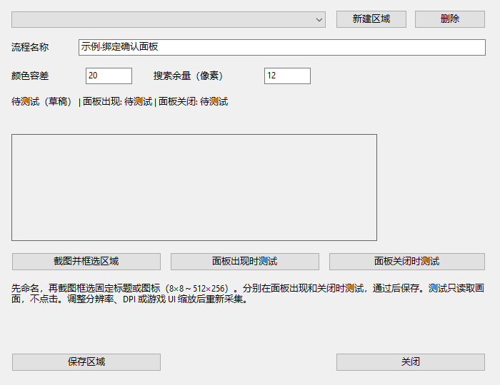
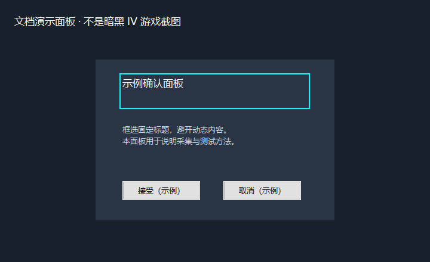
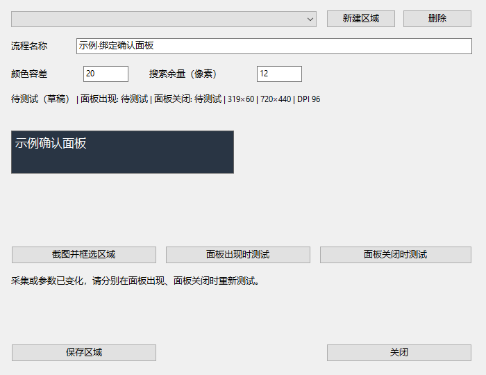
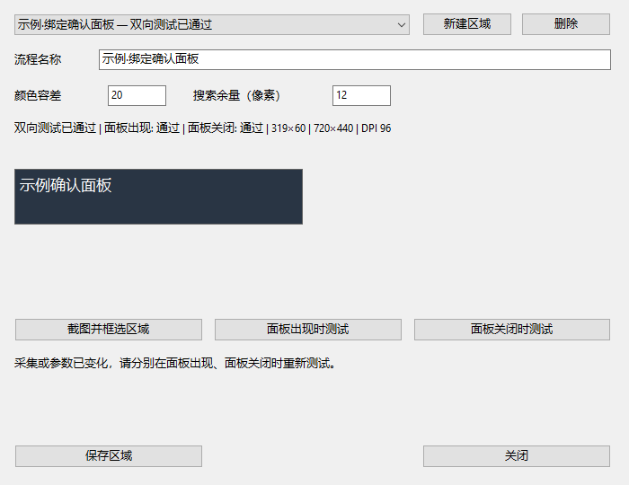
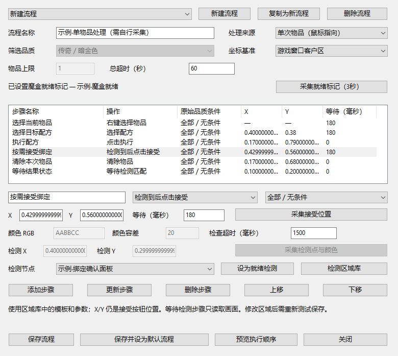

# 检测区域库

[手册首页](README.md) · 上一篇：[物品流程编辑](workflows.md) · 下一篇：[流程快捷键](hotkeys.md)

检测区域保存一小块画面及其检测参数。完成测试后，可以在多个流程中按名称选择它。区域本身只回答“画面是否匹配”，点击哪个按钮、等多久、匹配后做什么由流程决定。

**本篇框选图片使用合成演示面板，不是暗黑 IV 截图。** 测试结果来自该面板；请按相同步骤对自己的游戏画面采集和验证。

## 目录

- [准备与命名](#prepare)
- [截图并框选区域](#capture)
- [调整检测参数](#parameters)
- [分别验证出现和关闭](#test)
- [保存并在流程中引用](#reuse)
- [修改、删除与重新标定](#maintain)

## 1. 准备与命名

1. 停止按键宏和物品流程。
2. 打开暗黑 IV，将要识别的面板准备好，例如物品绑定确认框。
3. 从主窗口或流程编辑器打开“检测区域库”。
4. 点击“新建区域”，填写名称，例如“绑定确认框·标题”。当前版本名称输入框沿用“流程名称”标签，在此填写的是**区域名称**。

命名最好包含用途和画面特征，例如“魔盒就绪·固定标题”“绑定确认框·标题”“清除完成·空槽”。不同状态分别建立节点，便于复用和排查。

## 2. 截图并框选区域

1. 点击“截图并框选区域”。主程序相关窗口暂时隐藏，开始 3 秒倒计时。
2. 在倒计时结束前切回暗黑 IV，让目标面板可见，保持游戏在前台。
3. 程序自动截取游戏客户区并打开冻结画面。**不需要自己调用系统截图工具。**
4. 在冻结画面上按住左键拖出矩形，框住一块稳定特征；松开完成。按 Esc 可取消。
5. 返回区域库后检查局部预览，确认没有把错误状态或遮挡内容录入。

矩形框选操作不会传递给游戏。支持的选区尺寸是 `8×8～512×256` 像素。

| 推荐框选 | 应避免 |
| --- | --- |
| 固定标题文字、独特图标、稳定边框组合 | 物品名称、随机词缀、数量或倒计时 |
| 面板关闭后会明显消失的区域 | 大片纯黑／纯灰背景，其他面板也会出现的相同底色 |
| 没有悬停特效的位置 | 接受按钮高亮、鼠标提示框、动画或闪烁元素 |

尽量选择小而有辨识度的区域，而不是整个弹窗。大区域容易把动态内容和遮挡一起包含进来。

如果只看到主窗口隐藏，却没有冻结画面，先检查游戏是否打开且在倒计时结束时处于前台，详见[采集失败排查](troubleshooting.md#capture)。

## 3. 调整检测参数

| 参数 | 默认值 | 意义 |
| --- | --- | --- |
| 颜色容差 | 20 | 每个 RGB 通道允许的颜色差；范围 0～100 |
| 搜索余量（像素） | 12 | 在原采集位置附近查找模板的余量；范围 0～80 |

容差不是“相似度百分比”，数值越大越宽松。先用默认值测试，失败时优先检查选区、画面尺寸和遮挡，再小幅调整。过大的容差会增加把背景误认为面板的可能。

搜索余量只应对模板附近的小幅偏移，不是全屏搜索，也不会按模板移动距离自动调整接受按钮的点击坐标。

## 4. 分别验证“出现”和“关闭”

### 面板出现时测试

1. 在游戏中打开目标面板。
2. 回区域库点击“面板出现时测试”。
3. 在倒计时内切回游戏，让目标区域完整可见，等待结果。
4. 预期显示“面板出现：通过”。

### 面板关闭时测试

1. 在游戏中关闭目标面板，尽量保持与实际流程相近的背景。
2. 回区域库点击“面板关闭时测试”。
3. 在倒计时内切回游戏，保持面板关闭，等待结果。
4. 预期显示“面板关闭：通过”。也可以在容易混淆的其他面板上重复这项测试。

两种测试都只读取画面，不会点击游戏。每项测试连续采样 3 次、间隔约 100ms，全部符合预期才通过。

| 结果 | 如何理解 | 下一步 |
| --- | --- | --- |
| 出现通过、关闭通过 | 本次正反样本都符合预期 | 保存；在实际流程中小范围验证 |
| 出现失败 | 真正显示时没有稳定匹配 | 查尺寸／DPI、遮挡、选区内容和容差 |
| 关闭失败 | 未显示时仍能匹配 | 换更独特的特征，缩小选区或降低容差 |
| 待测试 | 新采集或参数修改后证据尚不完整 | 重新做对应测试 |

双向测试通过仅说明这些样本匹配正确，不能保证所有游戏背景下都不会误识别。

## 5. 保存并在流程中引用

1. 两项测试通过后点击“保存区域”。未通过也能保存草稿，但不能作为新的可用检测节点选择。
2. 关闭区域库，回到流程编辑器。
3. 选择“等待检测匹配”或“检测到后点击接受”，在“检测节点”中选择区域名称。
4. 点击“更新步骤”，然后保存流程。

按用途区分：

| 用途 | 在流程里怎么设置 | 没检测到的结果 |
| --- | --- | --- |
| 启动前确认魔盒就绪 | 选中就绪区域，点击“设为就绪检测” | 就绪检查不通过，流程不能继续 |
| 有绑定弹窗时才接受 | 动作选“检测到后点击接受”，仍需单独采集接受按钮位置 | 检查超时后跳过该步骤 |
| 等待必需的界面状态 | 动作选“等待检测匹配”并选节点 | 检查超时后停止流程 |

设置就绪区域时，可以先将当前步骤操作选为支持检测的类型，让“检测节点”可选，再选择区域并点击“设为就绪检测”。就绪设置与当前步骤独立：操作后仍应核对当前步骤需要引用的节点，尤其不要把确认框步骤误改成就绪区域。

使用区域节点时，颜色、容差、检测点等对应的单点参数不参与匹配；区域库里的模板和参数才生效。“单点颜色（原设置）”可切回旧式像素检查。

## 6. 修改、删除与重新标定

- **改名**：引用按内部 ID 保存，改名不会破坏已有流程引用。
- **重新采集、改容差或搜索余量**：测试状态失效，需要重新测试并保存。未保存的编辑不会更改磁盘上供流程使用的节点。
- **删除**：已被保存流程或打开的草稿引用时不能删除，先解除引用。
- **换窗口尺寸或 DPI**：与采集时不一致会报错，需要重新采集测试。
- **改游戏 UI 缩放或布局**：即使窗口尺寸相同也可能失配，需要人工重新标定。

模板保存在数据目录的 `.runtime\detection-regions`，包含 INI 与 BMP 图像。备份时整个复制，不要只留名称配置。完整截图在框选完成／取消后移除；历史局部模板可能保留，不能因看起来未使用就随意删除。[数据位置与备份](updates-and-backup.md#data)有完整说明。

---

[← 物品流程编辑](workflows.md) · [下一篇：流程快捷键 →](hotkeys.md)
