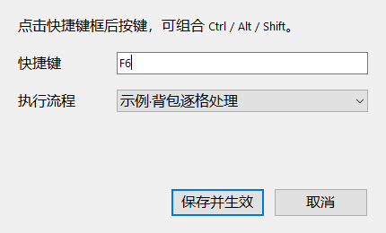
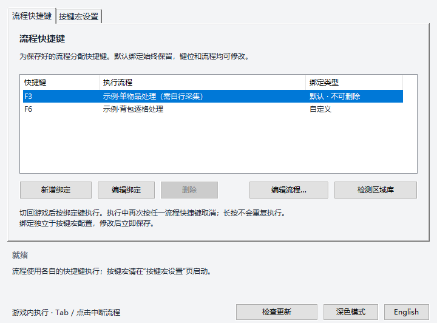

# 流程快捷键

[手册首页](README.md) · 上一篇：[检测区域库](detection-regions.md) · 下一篇：[更新与备份](updates-and-backup.md)

你可以让 F3 执行单物品流程，再让 F6 执行另一个背包流程。默认绑定始终保留，但它的按键和流程都能修改。

## 目录

- [修改默认绑定](#default)
- [新增其他流程键](#add)
- [按键冲突与限制](#conflicts)
- [运行、取消与保存规则](#execution)

## 1. 修改默认绑定

1. 在主窗口打开“流程快捷键”页。
2. 选中“默认 · 不可删除”这一行，点击“编辑绑定”，也可以双击该行。
3. 点击“快捷键”框，直接按下所需按键或组合键，选择要执行的已保存流程，点击“保存并生效”。
4. 核对列表里的快捷键和执行流程名称。

初始键位为 F3。不能删除的是默认这条绑定，而不是把键位固定死为 F3。

在流程编辑器点击“保存并设为默认流程”，会把这条默认绑定的流程换成当前流程，保留当前键位。只点“保存流程”或在编辑器顶部切换流程，都不会替换默认绑定。

## 2. 新增其他流程键

1. 先在编辑器保存需要的流程。
2. 回主窗口点击“新增绑定”。
3. 点击“快捷键”框，按下一个未占用的快捷键，例如 F6，选择流程；不要把 `F6` 当普通文字逐字符输入。
4. 保存后确认列表新增了一行。

可增加至多 32 条绑定（包含默认绑定）。自定义绑定可选中后删除；删除绑定不等于删除流程。要删除一个仍被绑定的流程，先改绑或删除相关自定义绑定，默认行则改绑到别的流程。

## 3. 按键冲突与限制

| 情况 | 规则 |
| --- | --- |
| 普通键盘按键 | 可使用未冲突的键，例如 F3、F6 |
| Ctrl / Alt / Shift 组合 | 支持组合，使用编辑框录入需要的组合 |
| 已被其他流程占用 | 拒绝重复绑定 |
| Tab | 保留给游戏和暂停／中断逻辑 |
| Ctrl+Alt+F8 | 保留给窗口诊断 |
| 鼠标按键或单独修饰键 | 不能作为流程快捷键 |
| 与宏启停键同一主键 | 即使附加修饰键也冲突，例如宏 F1 与流程 Ctrl+F1 |

修改绑定前先停止宏、流程及采集。遇到冲突按提示换键，不要通过手改 INI 绕过检查。

## 4. 运行、取消与保存规则

绑定修改后立即保存，并独立于四套宏配置。切换宏配置或主界面页面不会改变这些绑定。

- 启动流程时，暗黑 IV 必须在前台，并满足流程就绪及其他运行条件。
- 执行中再次按**任意流程键**会取消当前流程；不会切换去执行另一个绑定。
- 长按不会反复启动；采集期间不会启动流程。
- 草稿可以出现在绑定列表，但未通过运行条件检查时仍不能执行。
- 程序启动时若发现绑定配置损坏、流程丢失或冲突，会提示并暂不启用流程快捷键，不会静默替换成其他流程。

例如 F3 的流程正在运行时按 F6，结果是取消 F3 这次流程。检查游戏状态后，下一次按 F6 才是重新从头运行 F6 对应的流程。

按键无响应时，按[快捷键故障排查顺序](troubleshooting.md#workflow-key)检查绑定、游戏前台和草稿条件。

---

[← 检测区域库](detection-regions.md) · [下一篇：更新与备份 →](updates-and-backup.md)
