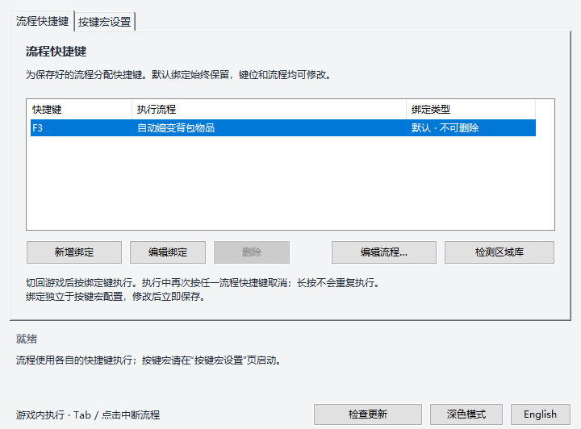

# 安装与启动

[手册首页](README.md) · 下一篇：[快速上手](quick-start.md)

本篇目标：下载正确的主程序，把它放在固定目录，看到 d4box 主窗口。

## 目录

- [运行条件](#requirements)
- [下载哪个文件](#download)
- [解压与首次启动](#first-launch)
- [可选：核对下载校验值](#checksum)
- [开发者：从源码运行](#source)

<a id="requirements"></a>
## 1. 运行条件

- Windows x64 环境；当前发行包为 x64 程序。
- 一个有写入权限的固定文件夹，例如 `D:\Games\d4box`。
- 要执行流程或采集检测区域，需要已启动的暗黑 IV 游戏窗口。
- 下载、检查更新需要访问 GitHub；本地编辑配置不需要 GitHub 登录。

**发行版无需安装 AutoHotkey、Qt 或 Visual Studio。** 主程序已包含所需 AHK 运行时。没有游戏时可以先浏览界面、编辑草稿；截图采集与游戏操作要等游戏打开后再做。

<a id="download"></a>
## 2. 下载哪个文件

打开 [d4box Releases](https://github.com/liuapart/d4box/releases)，选择标签为 `d4box-vX.Y.Z` 的主程序稳定版本，展开该版本的 **Assets**。

下面用本手册对应的 [v0.3.1 发布页](https://github.com/liuapart/d4box/releases/tag/d4box-v0.3.1) 举例。安装其他版本时，文件名中的版本号会相应变化。

| 文件 | 用途 | 如何选择 |
| --- | --- | --- |
| `D4Box-v0.3.1-windows-x64.zip` | 便携包，含程序和许可说明 | 初次使用推荐 |
| `D4Box-v0.3.1-windows-x64.exe` | 可直接运行的独立程序 | 只需主程序或更新现有安装时使用 |
| `SHA256SUMS.txt` | 下载文件的 SHA-256 校验清单 | 需要核对文件完整性时下载 |
| `Source code (zip / tar.gz)` | GitHub 自动生成的源码压缩包 | 用于开发，不是可直接运行的便携包 |

旧 `editor-v*` 是独立编辑器的历史版本，不是现在的主程序。不要把它当成使用 d4box 的前置依赖。

<a id="first-launch"></a>
## 3. 解压与首次启动

1. 在资源管理器中新建固定文件夹，例如 `D:\Games\d4box`。
2. 下载 ZIP 后右键选择 Windows 的“全部解压缩”，将内容解压到该文件夹。**不要在压缩包预览窗口中直接运行 EXE。** 如果下载的是独立 EXE，直接把它移动到这个文件夹。
3. 打开解压后的目录，双击其中的 EXE。可以将独立下载的版本化文件重命名为 `D4Box.exe`，方便以后保留同一个快捷方式。
4. 主窗口出现后，确认有“流程快捷键”和“按键宏设置”两个页面。窗口标题显示版本；底部“检查更新”也能查看当前版本。
5. 后续始终从这个目录启动。不要把每次下载的新 EXE 留在不同目录运行，否则会使用另一套配置。

启动后的界面：



预期结果：可以打开“编辑流程…”和“检测区域库”；暂时不需要启动宏或按 F3。

程序使用后会在旁边保存数据，目录大致如下：

```text
D:\Games\d4box\
├─ D4Box.exe           主程序（也可能保留带版本号的文件名）
├─ settings.ini        界面和按键宏配置
├─ .runtime\           自定义流程、快捷键、区域模板等
└─ debugd4.log         运行日志
```

这些数据会按需创建，不要求首次打开时所有文件都已出现。不要安装在只读目录，也不要随手清理 `.runtime`。

若 Windows 提示未识别发布者：当前 EXE 未做代码签名。先确认文件来自本仓库发布页并核对完整性；不要为运行它全局关闭系统安全保护。组织策略阻止运行时，应按本机管理要求处理。

<a id="checksum"></a>
## 4. 可选：核对下载校验值

将 `SHA256SUMS.txt` 与下载文件放在同一目录，在该目录打开 PowerShell。以 v0.3.1 ZIP 为例：

```powershell
Get-FileHash -LiteralPath '.\D4Box-v0.3.1-windows-x64.zip' -Algorithm SHA256
Get-Content -LiteralPath '.\SHA256SUMS.txt'
```

将输出的哈希与清单中**同名文件**那一行比较，大小写不影响比较。下载 EXE 时把命令里的文件名改成 EXE。若不一致，重新下载并核对，不要继续运行该文件。哈希用于检查文件完整性，不等同于代码签名。

<a id="source"></a>
## 5. 开发者：从源码运行

普通使用到这里即可跳到[快速上手](quick-start.md)。修改 AHK 源码时才需要下面的步骤。

在仓库根目录打开 PowerShell。准备官方 [AutoHotkey v2](https://www.autohotkey.com/) 解释器后，可以放到项目忽略目录：

```text
d4box\
├─ .runtime\autohotkey\v2\AutoHotkey64.exe
├─ app\ahk\D4Box.ahk
└─ scripts\start-windows.ps1
```

运行：

```powershell
.\scripts\start-windows.ps1
```

已有系统安装时，也可以明确指定**实际存在**的 v2 解释器：

```powershell
.\scripts\start-windows.ps1 -AhkPath 'C:\Program Files\AutoHotkey\v2\AutoHotkey64.exe'
```

`-AhkPath` 是解释器的文件路径，不是 d4box 程序路径。启动脚本不会自动安装解释器；若报路径不存在，先用 `Test-Path -LiteralPath '实际路径'` 检查。AutoHotkey v1 不能替代 v2。

源码运行时，用户数据写入 `app\ahk`；发行版写入 EXE 所在目录。[迁移配置](updates-and-backup.md#migrate)时需要区分这两个位置。自己编译 EXE 请阅读[构建与发布](../ahk-release.md)，也不需要 VS。

---

[← 手册首页](README.md) · [下一篇：快速上手 →](quick-start.md)
