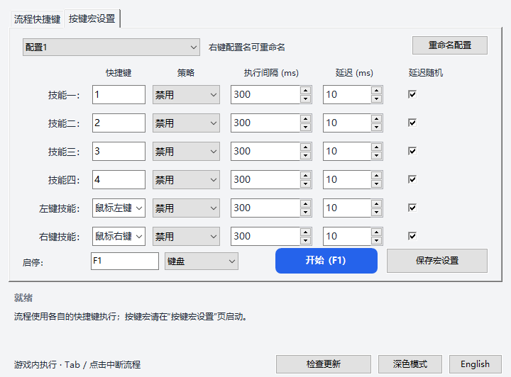
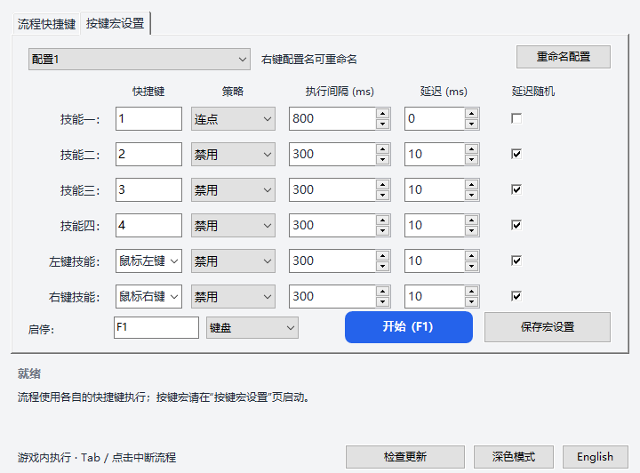

# 按键宏

[手册首页](README.md) · 上一篇：[快速上手](quick-start.md) · 下一篇：[物品流程编辑](workflows.md)

按键宏用于重复触发技能或保持按住。它与物品流程分别配置，宏启停键默认是 F1。

## 目录

- [选择并保存配置](#profiles)
- [设置技能策略](#strategies)
- [间隔与延迟的含义](#timing)
- [启停键与运行状态](#runtime)

## 1. 选择并保存配置

1. 打开主界面的“按键宏设置”页。
2. 在左上角选择配置。共有四套，可分别存放不同角色或技能组合。
3. 点击“重命名配置”，用容易辨认的名称区分。
4. 修改下方技能和鼠标行，完成后点击“保存宏设置”。界面编辑也有自动保存，但明确保存后再试用更容易核对。

宏启停键和流程快捷键绑定独立于这四套配置。切换宏配置不会替你把 F3 改绑到另一个物品流程。调整配置前先停止宏，避免混淆正在使用的设置。

## 2. 设置技能策略

“技能一”至“技能四”的快捷键应与你在游戏中的实际绑定一致。左键技能和右键技能在各自的行设置。

| 策略 | 行为 | 配置建议 |
| --- | --- | --- |
| 禁用 | 这一行不参与宏 | 不需要自动触发的技能保持禁用 |
| 连点 | 按定时器间隔重复触发 | 首次验证只启用一行，方便观察 |
| 维持BUFF | 根据技能栏的绿色状态条判断是否需要补按 | 依赖技能栏位置和画面，需要在实际布局下验证 |
| 按住 | 保持相应键按下，停止／暂停时释放 | 仅用于需要持续按住的操作 |

“维持BUFF”不是读取技能冷却或识别文字；它依赖底部居中的技能栏及相应画面位置。移动技能栏、改变 UI 缩放或使用不匹配的显示布局，都可能影响判断。

首次配置示例：只让技能一连点，其他全部禁用。

## 3. 间隔与延迟的含义

时间单位都是毫秒，`1000ms = 1 秒`。

| 字段 | 含义 |
| --- | --- |
| 执行间隔 | 该行定时器的基础间隔 |
| 延迟 | 加到基础间隔上的时间；关闭随机时可为有符号数值 |
| 延迟随机 | 开启后，从 `0` 到延迟绝对值之间取随机增量 |

例如基础间隔为 `800`，延迟为 `100`：

- 不勾选随机：实际定时器间隔为 `900ms`。
- 勾选随机：本次定时器启动时选取 `800～900ms` 之间的间隔。
- 延迟为 `0`：实际为 `800ms`。

实际间隔下限是 `20ms`。随机值在定时器**启动或重启时**计算，不是每次按键都重新抽取。对于“维持BUFF”和“按住”，间隔表示策略检查频率，不能直接当作技能施放频率。

不要把某个技能的宏延迟与物品流程里的“等待（毫秒）”混为一谈：前者影响宏定时器，后者属于单个流程步骤。

## 4. 启停键与运行状态

在页面下方“启停”处选择键盘或支持的鼠标按键类型，再设置按键。默认键盘 F1；鼠标可选择中键、侧键等界面提供的选项。保存后，开始按钮上的提示会反映当前绑定。

切回暗黑 IV 后按启停键开始，再按一次停止。也可以从界面点击“开始”；游戏不在前台时宏不会持续向其他窗口发送操作。因为切换窗口而自动暂停的宏，在回到游戏且不是手动暂停状态时会继续。

| 状态或操作 | 结果 |
| --- | --- |
| 游戏前台按启停键 | 开始／停止宏 |
| 宏运行中按 Tab | 切换手动暂停／继续，同时将 Tab 发送给游戏 |
| 切出游戏 | 运行中的宏自动暂停 |
| 回到游戏 | 仅因窗口切换而暂停的宏可继续；手动暂停不会因此解除 |
| 开始物品流程 | 暂停宏定时器并释放按住的键 |
| 流程正常结束 | 满足原先在运行、未暂停且游戏仍在前台等条件时恢复宏 |
| 流程失败或中断 | 不自动恢复宏，检查状态后再决定是否启动 |

宏启停键不能与流程快捷键使用同一主键。例如宏使用 F1 时，流程也不能用 Ctrl+F1；冲突处理见[流程快捷键](hotkeys.md#conflicts)。

如果状态显示已暂停或按键没反应，先查[故障排查](troubleshooting.md#macro)，不要一次把所有技能都改成连点。

---

[← 快速上手](quick-start.md) · [下一篇：物品流程编辑 →](workflows.md)
