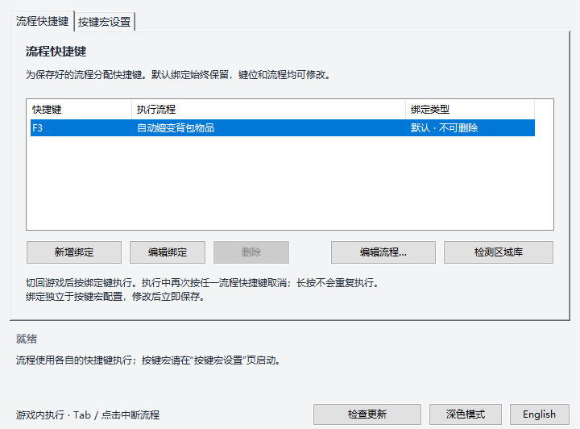
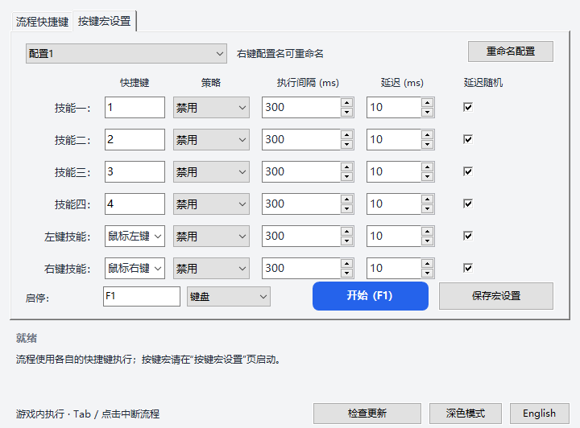
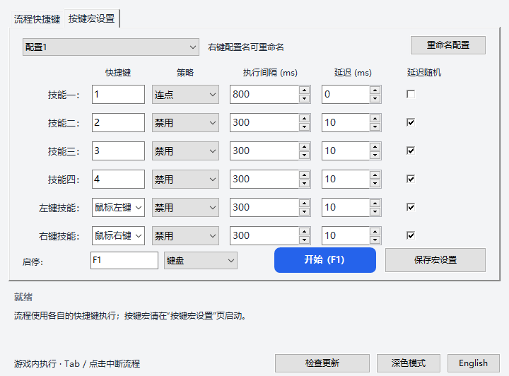
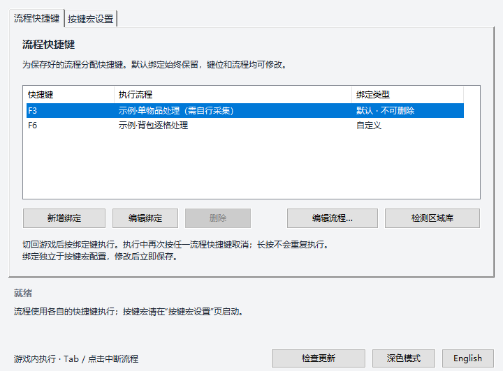
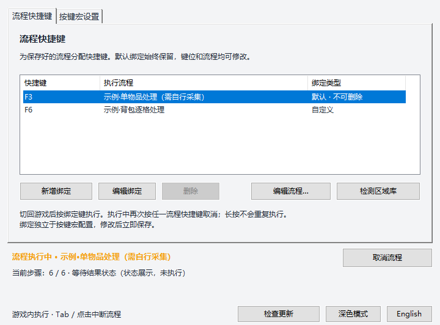

# 快速上手与界面导航

[手册首页](README.md) · 上一篇：[安装与启动](installation.md) · 下一篇：[按键宏](macros.md)

本篇帮助你找到正确入口，完成第一次配置，并知道如何停止。物品流程的坐标和检测条件需要在自己的游戏画面上采集，不能直接照抄截图数字。

## 目录

- [认识主界面](#interface)
- [第一次使用按键宏](#first-macro)
- [第一次使用物品流程](#first-workflow)
- [查看进度与停止](#stop)

## 1. 认识主界面

| 区域 | 可以做什么 |
| --- | --- |
| “流程快捷键”页 | 查看各按键对应的流程，新增／编辑绑定，打开流程编辑器和区域库 |
| “按键宏设置”页 | 选择四套宏配置，修改技能策略和时间参数，设置宏启停键、启动或停止宏 |
| 公共底部 | 观察运行状态、当前流程与步骤，操作当前可用的停止／取消控件，查看通知与更新，切换主题和语言 |

切换 Tab 页面只改变显示内容。流程快捷键和宏启停键不会随页面切换而改绑。

默认 F1 是宏启停键；默认 F3 是第一条流程绑定。它们都可以修改，后续说明中的 F1/F3 均以你保留默认设置为前提。

## 2. 第一次使用按键宏

1. 打开“按键宏设置”，选择“配置1”，可用“重命名配置”改成有意义的名称。
2. 只启用“技能一”：快捷键填与你游戏绑定一致的键；策略选“连点”。初次观察可设置执行间隔 `800` 毫秒、延迟 `0`，取消“延迟随机”。其余行保持“禁用”。
3. 点击“保存宏设置”。
4. 切回游戏，在适合测试该技能的场景按宏启停键（默认 F1），观察是否按预期触发。
5. 再按同一个键停止。确认停止后再逐项启用其他技能。

预期结果：只有你启用的技能参与宏；停止后不再持续发送按键。这里的 `800ms` 是便于观察的示例，不代表所有技能都适用。

参数解释和暂停规则见[按键宏](macros.md)。

## 3. 第一次使用物品流程

建议先验证一个物品，再扩展成背包遍历。

1. **停止按键宏**，在游戏中打开要操作的魔盒／配方面板，保持分辨率和 UI 缩放固定。
2. 主程序 →“流程快捷键”→“编辑流程…”→“新建流程”。给流程命名，处理来源选“单次物品（鼠标指向）”，坐标基准选“游戏窗口客户区”。新流程带有起始步骤，仍需按你的目标修改。
3. 按[流程编辑的逐步示例](workflows.md#single-item)设置右键选择物品、选择配方、执行、按需接受、清除和末尾检测。逐个采集点击位置，不复制文档里的坐标。
4. 设置**启动前就绪检查**与**结束时检测**。要复用画面检测，先按[检测区域教程](detection-regions.md)完成采集、出现测试、关闭测试和保存，再回流程选节点。
5. 点击“预览执行顺序”检查顺序；点击“保存并设为默认流程”。如果提示缺少运行条件，先补齐，再试运行。
6. 回主窗口确认 F3 那一行显示的就是这个流程。仅在编辑器下拉框切换流程不会改变 F3 绑定。
7. 切回游戏，打开流程要求的起始面板；若包含“右键选择物品”，把鼠标放到目标物品上，再按 F3。没有该步骤时，要先手动放入物品。
8. 完成后检查游戏中的实际结果。确认有绑定弹窗和没有绑定弹窗两种情况都符合预期，再增加自动处理范围。

预期结果：流程从正确的初始界面启动，只操作选中的一个物品，末尾检查通过。若被拒绝，按提示修正；不要仅增加延时来绕过就绪或结果检测。

内置“自动嬗变背包物品”保留了原有坐标与流程，不表示已适配你的分辨率、布局和游戏界面。自定义流程可以保存草稿，草稿不满足条件时不会执行。

## 4. 查看进度与停止

上图仅用于展示流程名、步骤和取消入口的位置；截图中的状态由文档演示数据生成，未实际执行流程。

| 当前情况 | 如何停止或暂停 |
| --- | --- |
| 按键宏运行中 | 再按宏启停键（默认 F1）停止；也可使用主界面停止控件 |
| 按键宏运行中想临时暂停 | 游戏中按 Tab 切换暂停／继续；Tab 本身仍传递给游戏 |
| 物品流程执行中 | 再按任意已绑定的流程快捷键取消当前流程，或使用“取消流程” |
| 物品流程执行中手动介入 | 游戏中的手动左／右键点击或 Tab 会中断流程；切出游戏也会中止 |
| 区域框选中 | 按 Esc 取消选区 |

流程失败或被中断后，先检查游戏当前状态，再重新开始。重新按快捷键会从流程开头执行，不会从上次失败步骤续跑。

单物品流程在**最后一个鼠标操作**完成后尽早把鼠标放回启动位置，随后继续延时和末尾检测。因此鼠标归位不等于流程已结束，应以状态和实际结果判断。

---

[← 安装与启动](installation.md) · [下一篇：按键宏 →](macros.md)
