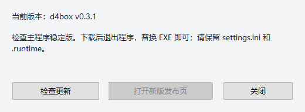

# 更新、备份与迁移

[手册首页](README.md) · 上一篇：[流程快捷键](hotkeys.md) · 下一篇：[故障排查](troubleshooting.md)

d4box 是便携程序。更新时退出后替换 EXE，保留旁边的配置和 `.runtime` 数据目录。

## 目录

- [检查与安装更新](#update)
- [用户数据在哪里](#data)
- [备份与恢复](#backup)
- [从源码迁移或换目录](#migrate)
- [独立 editor 的历史版本](#archive)

## 1. 检查与安装更新

1. 点击主窗口底部“检查更新”，查看当前主程序版本和查询状态；需要重试时用窗口内“检查更新”。
2. 有可用稳定版本时，点击“打开新版发布页”，阅读版本说明并下载新 EXE 或便携 ZIP。
3. 停止宏和流程，保存编辑内容，点击主窗口关闭按钮**退出程序**。
4. 按下一节备份，再将原目录里的 EXE 替换为新版。若使用 ZIP，只取出新版程序及随包说明，保留已有用户数据。
5. 从原目录启动新版，确认版本、宏配置、流程绑定和区域库都在；窗口布局改变后先重新验证检测。

当前更新检查只读取本仓库完整的稳定 AHK 主程序发布，跳过旧 `editor-v*`、草稿、预发布和缺少必要资产的版本。无需 GitHub 登录；网络失败可重试，也可直接打开[发布页](https://github.com/liuapart/d4box/releases)。

更新器不会自动下载、安装或替换正在运行的 EXE。若旧快捷方式指向 `D4Box.exe`，保持这个文件名即可继续使用同一快捷方式。

## 2. 用户数据在哪里

“数据目录”取决于启动方式：

| 启动方式 | 数据目录 |
| --- | --- |
| 下载的独立 EXE / 便携包 | EXE 所在文件夹 |
| 仓库源码 `app\ahk\D4Box.ahk` | 仓库里的 `app\ahk` |

以下路径都相对于这个数据目录：

| 路径 | 内容 | 如何保留 |
| --- | --- | --- |
| `settings.ini` | 按键宏、预设名称、界面及通用设置 | 备份 |
| `.runtime\cube-workflows.ini` | 自定义流程及相关选用信息 | 备份 |
| `.runtime\workflow-hotkeys.ini` | 默认及新增流程快捷键绑定 | 备份 |
| `.runtime\detection-regions\regions.ini` | 区域名称、参数、测试记录 | 与 BMP 一起备份 |
| `.runtime\detection-regions\*.bmp` | 区域模板图像 | 必须与 INI 配套 |
| `.runtime\window-diagnostics.log` | 窗口诊断信息 | 排查问题时保留 |
| `debugd4.log`、`debugd4.old.log` | 调试与轮转日志 | 排查问题时保留 |
| `.runtime\builtin`、`.runtime\licenses` | 编译版提取的内置数据与许可 | 可重新生成；整目录备份时一并保留即可 |

不要只备份流程 INI 而漏掉区域模板，也不要把 `.runtime\builtin` 当成用户流程编辑位置。仓库根目录还有用于构建工具的 `.runtime`，它与源码运行时 `app\ahk\.runtime` 不是同一个目录。

## 3. 备份与恢复

### 手动备份

1. 保存编辑内容，完全退出程序。
2. 打开上表对应的数据目录。
3. 将 `settings.ini` 和**整个 `.runtime` 文件夹**复制到带日期的备份文件夹。也可以备份整个便携目录。
4. 确认备份里有自定义流程、绑定，以及区域库的 INI 和 BMP。

### 恢复

1. 退出正在运行的 d4box，先备份当前数据。
2. 将备份中的 `settings.ini` 和 `.runtime` 恢复到 EXE 旁。恢复同一套数据，不要混合不同时间点的 INI 和模板。
3. 启动，核对宏配置、流程名称、各快捷键的绑定及检测区域预览。
4. 若换了机器、显示器、DPI、分辨率或 UI 缩放，重新采集／测试检测和点击坐标后再运行。

需要回退版本时，使用相应旧 EXE 和同一时期的配置备份。不要假定新版本写过的数据一定能被更旧版本完整读取。

## 4. 从源码迁移、换目录或换电脑

从源码切换到发行版：

1. 保存并退出源码运行的程序。
2. 将发行版放到新目录，暂不启动。
3. 从仓库的 `app\ahk` 复制 `settings.ini` 和整个 `.runtime` 到新 EXE 旁。
4. 只启动新目录的 EXE，核对所有绑定和区域预览。

便携版换目录时，移动或复制整个便携目录最直观。换电脑后还要重新验证画面尺寸和模板匹配，文件成功复制不代表坐标仍然有效。

## 5. 独立 editor 的历史版本

当前主分支只维护 AHK 主程序；流程编辑器和区域库已在主程序内，无需安装独立 editor。

历史 Qt editor 源码保留在标签 `archive/editor-before-ahk-only`，对应提交 `3ec4e87`。开发者恢复方法见[发布文档](../ahk-release.md)。旧 editor 草稿不是现在运行时使用的流程 INI，不应当作主程序配置备份直接覆盖。

---

[← 流程快捷键](hotkeys.md) · [下一篇：故障排查 →](troubleshooting.md)
