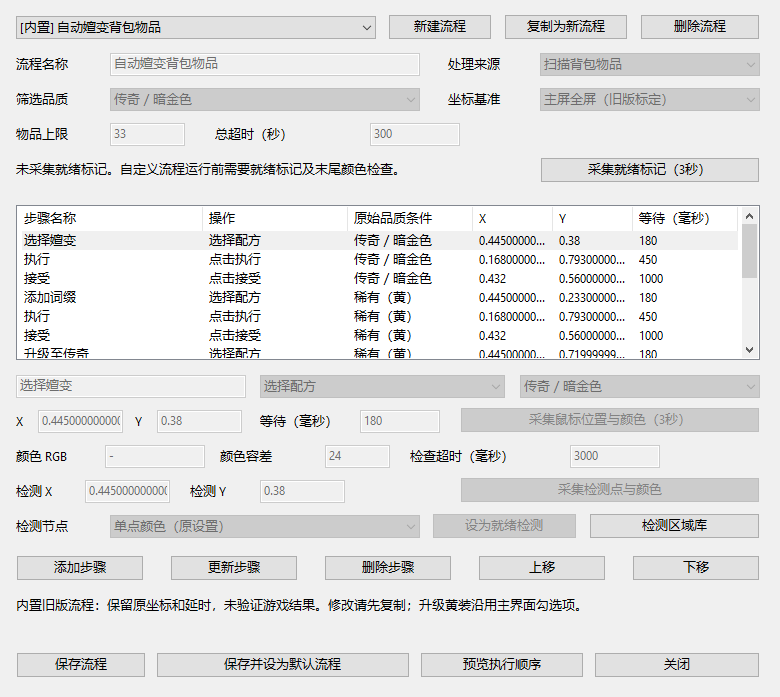
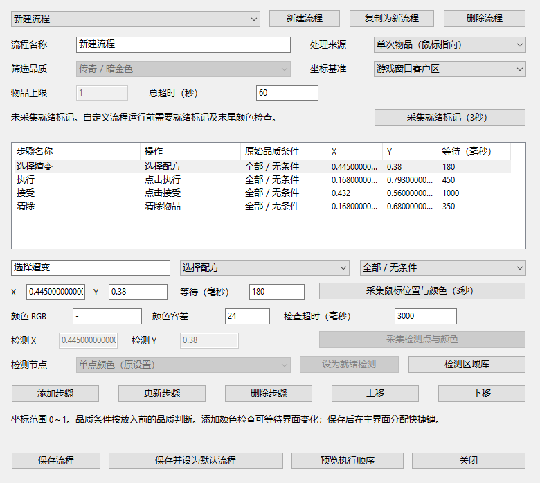
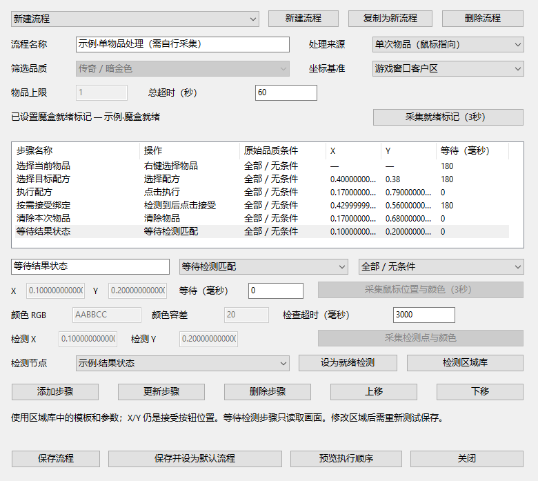
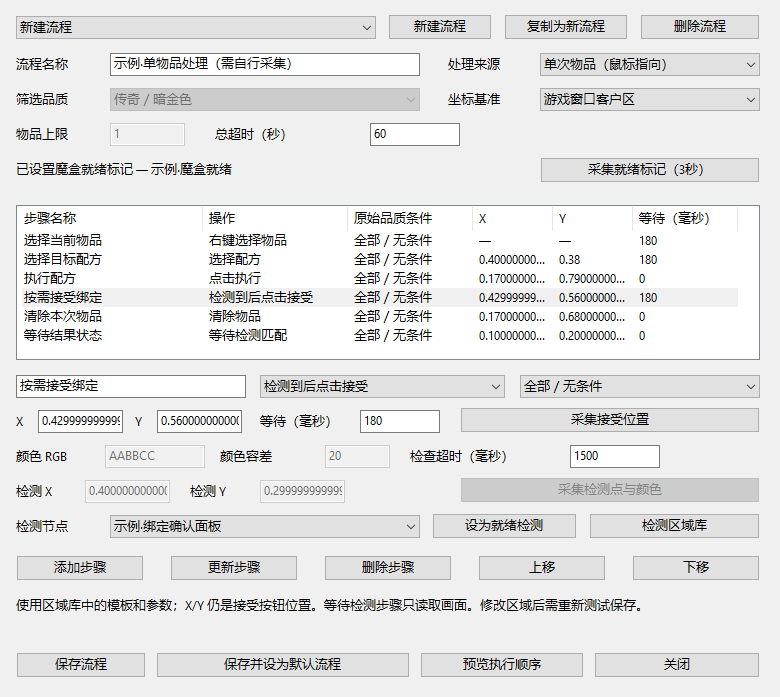
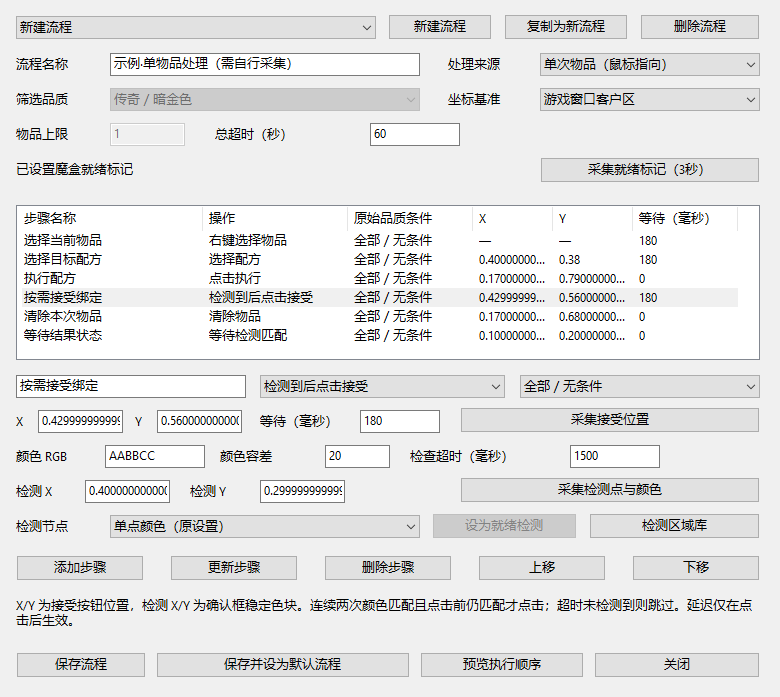
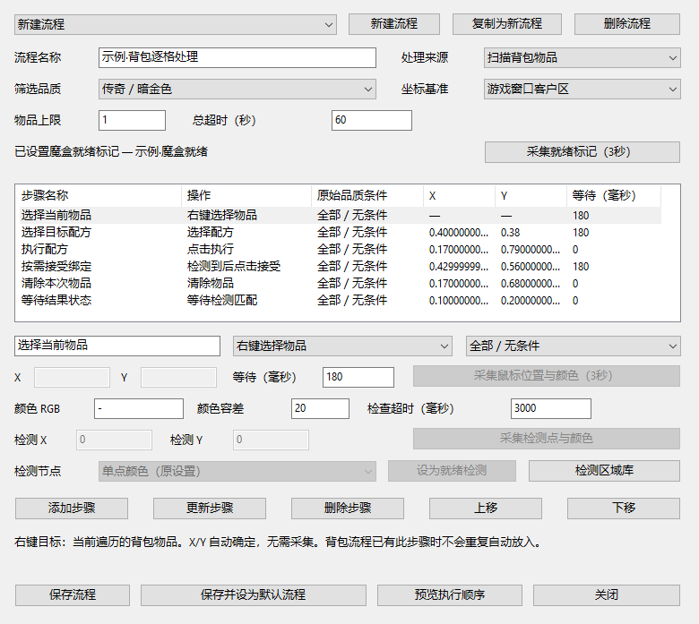

# 物品流程编辑

[手册首页](README.md) · 上一篇：[按键宏](macros.md) · 下一篇：[检测区域库](detection-regions.md)

流程把选择物品、选择配方、点击执行和检测结果组合成可保存的步骤序列。本篇从一个单物品流程开始，再介绍背包遍历。

**所有截图中的坐标和检测颜色都是说明界面的示例。** 请在自己的游戏里采集；本篇不提供已经完成游戏标定的配方。

## 目录

- [打开、新建与复制](#create)
- [两种物品来源](#source)
- [一步一步配置单物品流程](#single-item)
- [操作类型速查](#actions)
- [如何采集坐标和颜色](#coordinates)
- [检测到后点击接受](#optional-confirm)
- [保存、预览和执行](#save)
- [扩展成背包流程](#inventory)
- [执行范围与鼠标归位](#limits)

## 1. 打开、新建与复制

主窗口“流程快捷键”页 →“编辑流程…”。

| 操作 | 作用 |
| --- | --- |
| 顶部下拉框 | 打开某个流程进行查看或编辑，不直接改变快捷键绑定 |
| 新建流程 | 创建自定义流程，附带一组起始步骤 |
| 复制为新流程 | 从当前流程创建可编辑副本，适合改造内置流程 |
| 删除流程 | 删除可删除的自定义流程；被快捷键引用的流程需先改绑 |

内置流程只读，要改坐标、品质条件或动作，应先复制。“新建流程”也不是空白模板：它以现有传奇路径的步骤为起点，默认单物品、游戏客户区、一次处理一个物品、总超时 60 秒，并且尚无就绪标记。根据目标删改这些起始步骤。

## 2. 两种物品来源

| 设置 | 单次物品（鼠标指向） | 扫描背包物品 |
| --- | --- | --- |
| 执行范围 | 只执行一次 | 逐格识别并处理匹配品质的物品，受上限约束 |
| “右键选择物品”的目标 | 按流程快捷键时鼠标所在的位置 | 当前循环到的背包物品格 |
| 该右键步骤的 X/Y | 自动确定，禁用且忽略存储的 X/Y | 自动确定，禁用且忽略存储的 X/Y |
| 品质筛选和物品上限 | 不使用，控件禁用 | 使用流程的品质筛选和物品上限 |
| 步骤品质条件 | 全部／无条件 | 根据物品放入前的原始品质决定执行哪些步骤 |
| 没有右键步骤时 | 用户先手动放入物品 | 兼容旧流程，执行器自动放入一次 |
| 鼠标归位 | 最后一个鼠标动作后尽早归位 | 不做单物品归位 |

只有“右键选择物品”跟随物品来源。“选择配方”“点击执行”“清除物品”等操作依然使用各步骤自己采集的坐标。

## 3. 一步一步配置单物品流程

先停止宏，在游戏中准备好配方面板；把流程命名为能描述用途的名称，例如“单物品·配方处理”。

### 3.1 设置流程基本信息

1. “处理来源”选“单次物品（鼠标指向）”。
2. “坐标基准”选“游戏窗口客户区”。
3. 设置能覆盖所有步骤的“总超时（秒）”，初次可保留默认 60 秒，再按实际需要调整。
4. 通过“采集就绪标记（3秒）”读取启动前的稳定画面点，或按[区域库教程](detection-regions.md#reuse)选取一个已测试的就绪节点并点击“设为就绪检测”。

就绪标记要能区分“正确起始面板已打开”与“未打开／打开了别的面板”。它必须在流程执行前就存在；不能用执行后才出现的账号绑定弹窗作为就绪状态。

### 3.2 添加或修改步骤

编辑器中间是步骤列表，下方是当前步骤的编辑区。建议按下面的节奏操作：

1. 选中一行，在下方修改名称、操作、参数。
2. 点击“更新步骤”，确认列表中的对应行变化。
3. 要新增时，把下方表单改成新步骤所需内容，再点击“添加步骤”。它会将**当前表单内容追加到末尾**，不是先生成一个空行。
4. 用“上移／下移”调整顺序，“删除步骤”移除不需要的行。

这里给出一种常见结构；是否需要选择配方、清除等步骤，取决于实际游戏操作：

| 顺序 | 步骤示例名 | 操作 | 要设置的内容 |
| --- | --- | --- | --- |
| 1 | 选择当前物品 | 右键选择物品 | 无需填坐标；启动前鼠标指向物品 |
| 2 | 选择目标配方 | 选择配方 | 采集配方入口位置，设置必要等待 |
| 3 | 执行配方 | 点击执行 | 采集执行按钮位置 |
| 4 | 按需接受绑定 | 检测到后点击接受 | 采集接受位置，选择弹窗检测节点，设置检测超时 |
| 5 | 清除本次物品 | 清除物品 | 采集清除位置；仅在实际操作需要时保留 |
| 6 | 等待结果状态 | 等待检测匹配 | 采集最终预期画面，或选择最终状态区域节点 |

如果执行后必须等待界面变化才能点清除，可在清除前添加一个必需的“等待检测匹配”。不要仅因表中有六步就认为所有配方都适用这个顺序。

### 3.3 配置末尾检测

将最后一步设为“等待检测匹配”。可以使用单点颜色，也可以从“检测节点”选择已经测试并保存的区域。

结束条件应对应实际需要的完成状态。例如只检查“清除后空槽”只能证明相应界面状态，不能证明词缀或配方产出符合预期；必要时在清除前增加对结果画面的检查，并人工检查产物。

自定义流程可保存草稿，但运行前要求：有就绪检查、每条会执行的品质路径至少包含一次“点击执行”，并以“等待检测匹配”结束；引用的区域也要有效且测试通过。界面会提示尚缺的条件。

## 4. 操作类型速查

| 操作 | 实际行为 | 关键参数 |
| --- | --- | --- |
| 右键选择物品 | 右键当前来源确定的物品位置 | 不使用 X/Y；动作后的等待 |
| 选择配方 | 在所设位置点击左键 | X/Y、等待 |
| 点击执行 | 在执行按钮位置点击左键 | X/Y、等待 |
| 点击接受 | 无条件点击接受位置 | X/Y、等待；不检查是否存在弹窗 |
| 检测到后点击接受 | 条件匹配后点击一次；等待超时未匹配则跳过 | 接受 X/Y、独立检测点或区域节点、检测超时 |
| 清除物品 | 在所设位置点击左键 | X/Y、等待 |
| 等待 | 仅等待设定时间 | 等待毫秒数 |
| 等待检测匹配 | 等到目标颜色／区域匹配才继续；超时停止 | 检测位置或区域节点、检查超时 |

“等待（毫秒）”是步骤的等待参数；“检查超时（毫秒）”限制检测等待；“总超时（秒）”限制整个流程。给点击步骤采集了颜色，不会自动把它变成检查步骤。

## 5. 如何采集坐标和颜色

普通点击和单点检查步骤：

1. 在游戏里准备好要采集的面板。
2. 在编辑器选中步骤，点击“采集鼠标位置与颜色（3秒）”。
3. 在倒计时内切回游戏，将鼠标放在目标位置，等待采集完成；采集读取位置和颜色，不需要额外点击目标。
4. 回编辑器检查数值，点击“更新步骤”。

X/Y 使用 `0～1` 的归一化坐标，不能直接输入屏幕像素值。游戏客户区模式以游戏内部画面为基准；主屏模式以主屏幕为基准。内置流程的旧坐标依赖游戏铺满主屏，自定义流程也需要在分辨率、比例或 UI 布局改变后重新校准。

单点检查只比较采集的**那一个点**的 RGB，不自动包含周围区域。选择有辨识度、状态改变时确实会变化的稳定像素；复杂面板通常更适合[区域模板](detection-regions.md)。

## 6. “检测到后点击接受”

适合“有些物品弹出账号绑定确认框，有些物品不弹”的情况。放在可能触发弹窗的“点击执行”之后。

### 使用区域节点（推荐先测试后复用）

1. 在“检测区域库”为确认框采集稳定特征，分别通过“面板出现时测试”和“面板关闭时测试”，点击“保存区域”。
2. 回到流程，新增或修改步骤，操作选“检测到后点击接受”。
3. 在“检测节点”下拉框选确认框区域。
4. 让确认框显示出来，点击“采集接受位置”，倒计时内将鼠标放在真正的接受按钮上。
5. 设置检查超时。可先以 `1000～1500ms` 调试，再按实际弹窗出现延迟调整；这只是起点，不是保证适用的值。
6. 点击“更新步骤”，保存流程，分别验证会弹窗和不会弹窗的物品。

### 使用原有单点颜色

在“检测节点”选“单点颜色（原设置）”，先“采集接受位置”，再“采集检测点与颜色”。检测点选确认框内稳定且关闭时不会匹配的点，避开接受按钮的悬停变色。

### 运行时会发生什么

- 检测连续两次匹配后移动到接受按钮，点击前再复核一次，确认仍匹配才点一次左键。
- 在检查超时内始终没匹配：跳过这一步，不点击，也不额外等待点击后的延迟。
- 已点击：等待该步骤设定的点击后延迟，再继续。
- 模板丢失、节点未通过测试、游戏失焦、取消或总超时等属于错误／中断，会停止，不当作“没弹窗”跳过。

接受按钮的坐标与模板搜索位置独立，模板搜索余量不会帮你自动修正按钮坐标。该动作只负责按需接受，**不能替代末尾的必需结果检查**；点击成功也不等于确认框已经消失。

## 7. 保存、预览和执行

| 按钮 | 作用 |
| --- | --- |
| 更新步骤 | 把下方编辑内容更新到当前列表项 |
| 预览执行顺序 | 展示计划的步骤和目标来源，不移动鼠标或执行游戏操作 |
| 保存流程 | 保存流程内容，保留现有快捷键分配 |
| 保存并设为默认流程 | 保存内容，并将默认绑定改为当前流程；默认键位保持原值 |

完成保存后回“流程快捷键”页核对绑定。打开游戏起始面板，鼠标指向目标物品，再按对应流程键。执行中再次按任意流程键取消当前流程。[多键绑定教程](hotkeys.md)介绍如何同时保留不同流程入口。

## 8. 扩展成背包流程

1. 先确认单个物品的步骤和检测可靠，再复制出另一个流程。
2. “处理来源”改为“扫描背包物品”。
3. 选择实际需要的品质范围，初次将“物品上限”设为 `1`。
4. 审查每行的“原始品质条件”，保证每条实际路径都包含执行和末尾检测。
5. 保存后分配另一个快捷键，例如 F6，与单物品流程区分。

品质判断按物品原始边框颜色粗分；升级后的品质变化不会重新选择另一组步骤。它不识别收藏状态、词缀或材料余额。先把不打算处理的物品移出待处理范围，再开始小范围验证。

路径中有“右键选择物品”时，执行器只在该步骤选择当前背包格，不会再提前自动放入；没有这个步骤的旧背包流程会自动放入一次。

## 9. 执行范围与鼠标归位

单物品流程在最后一个鼠标步骤完成后，先把鼠标移回启动位置，再进行该步骤的后续延时及末尾检测。最后鼠标步骤为可选接受时，点击或超时跳过后都可以归位；如果后面还有其他鼠标步骤，就暂不归位。

归位前已经发生取消、失焦、窗口变化、检查失败或总超时，则不再移动鼠标。归位后如果末尾检查失败，流程仍会停止。背包模式不执行这项归位。

流程执行期间会检查前台窗口、窗口位置和尺寸、超时及检测条件。它不提供 OCR 配方搜索、自动滚动找配方、读取材料余额或一次自动装入多件指定物品；预览通过与离线测试通过都不等于真实游戏操作成功。

需要了解数据格式和执行器规则时，阅读[流程技术参考](../cube-workflows.md)。

---

[← 按键宏](macros.md) · [下一篇：检测区域库 →](detection-regions.md)
