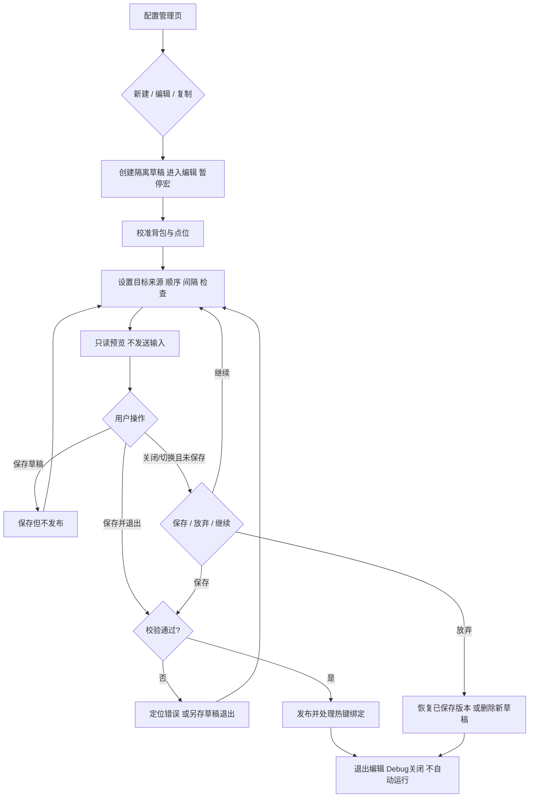
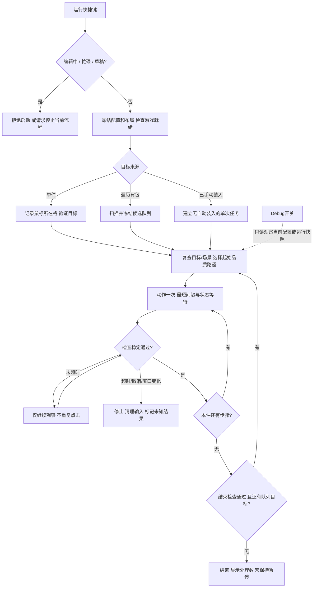

# D4Box 可视化流程编辑器：完整产品与交互方案

> 版本：设计草案 v0.2 · 2026-11-06
>
> 本轮只增加设计文档与静态设计图，不修改应用、配置格式、热键或执行逻辑。
>
> v0.2 依据用户提供的魔盒界面截图调整覆盖层与面板。叠加的控件、点位和编号仍是设计示意，不代表已实现、自动识别或实机验证。
>
> 原截图与合成预览仅放在 Git 忽略的 `.runtime` 目录；仓库设计资产只保留不含截图的透明 SVG，避免带入角色资料。

> **后续架构提议（2026-11-06）**：用户提出将编辑器拆为独立跨平台程序，通过 JSON 交给 AHK 执行。技术选型、文件/目录参数、Mac 截图模式及保存语义修订见 [独立编辑器方案](standalone-editor-plan.md)。本文的 v0.2 布局与深色配色继续沿用；第 9 节 AHK 编辑层方向、第 11 节待选文件格式，以及第 4 节双版本草稿规则由新方案提出替代，尚未实施。

### v0.2 的交互修订

- 原 GUI 的方案管理入口保留：选中已保存方案 → 点击“配置” → 进入全屏可视化编辑；新建直接进入编辑草稿。
- **全屏透明画布 + 顶部轻量工具栏 + 独立浮动步骤面板**。不把游戏缩进一个“预览区域”，不重绘一套假的游戏界面。
- 所有固定点击点可以拖到游戏客户区的任意位置；面板与工具栏不能成为点位可达性的障碍。
- 步骤面板**默认不打开**；点击顶栏“编辑步骤”才显示，可拖动、可关闭。仅保留显示/隐藏两态，不再设计折叠条。开始拖动点位时编辑控件临时避让，结束后不覆盖刚放好的点位。
- Debug 仅保留点位图标/短名称、背包线框和物品小序号；取消常驻顶栏、侧边说明、状态卡和编辑控件。

## 1. 产品定位与关键结论

把“填写坐标的配方表”升级为**在游戏界面上校准、编排、验证的可视化流程编辑器**。不把第一版做成复杂的自由连线编程工具。

用户应该能完成：新建 → 校准背包 → 放置点击点 → 编排顺序与等待条件 → 只读预览 → 保存 → 绑定快捷键 → 执行；需要排错时再显示 Debug。

### 本方案确定的默认规则

1. **新建直接进入未保存草稿**；修改只作用于草稿，不立即改变正在使用的配置。
2. **空白区域穿透，编辑控件不穿透**。背包内部默认也穿透；拖动靠边框和专用移动手柄，避免一次拖动同时操作游戏物品。
3. **循环关闭＝处理热键按下瞬间鼠标所在的背包物品一次**。循环打开＝处理本次扫描形成的有限目标队列，不是无限重复。
4. **目标、点位、步骤分开**。点位说明“在哪里”，步骤说明“按哪个键、什么时候执行、等待什么”；同一个点可以多次使用。
5. 保留时间间隔，但高风险动作采用**最短间隔 + 预期状态检查 + 超时停止**；不把点击完成误当成配方成功。
6. **保存不等于运行**。退出编辑后 Debug 默认关闭；快捷键只运行已发布且通过校验的版本。
7. 调试只观察、不点击；识别失败、不确定、位置变化时宁可停止，不猜测、不补点、不重试消耗动作。

## 2. 当前实现与本次设计的差距

根据当前仓库代码核对，而非仅依据上游介绍：

| 项目 | 当前实现 | 本次设计目标 |
| --- | --- | --- |
| 编辑器 | 表单、步骤列表、倒计时采集坐标 | 游戏上方的校准层 + 可移动配置面板 |
| 背包 | 固定比例的 11 列 × 3 行 | 8 点缩放、整体移动、参数化格线 |
| 步骤点击 | 普通步骤统一左键；装入由执行器隐式右键 | 明确的左键、右键；装入也是可见步骤 |
| 非批量来源 | 已手动放入，不自动装入 | 新增鼠标所在格单件；保留旧手动模式 |
| 检查 | 就绪取色、独立颜色检查 | 状态检查绑定动作；高风险动作强制结果检查 |
| 目标扫描 | 启动时扫描；循环内按颜色复查 | 单件与批量共用目标提供器，Debug 复用识别结果 |
| 热键 | F3 执行当前配置 | 保留 F3，增加配置专属快捷键与 Debug 开关 |
| 调试 | 日志、窗口信息 | 只读背包线框、候选编号、点位和失败定位 |

当前扫描依赖 `isAutoTransmuting`，不能直接拿来当空闲 Debug 的扫描服务；需在实现阶段解耦。现有颜色规则只能粗分传奇/暗金色、黄色、蓝色、暗色与未知，不识别具体物品或收藏。

## 3. 信息架构与界面分区

### 3.1 配置管理页

入口明确为：**原主 GUI → 配方流程/方案管理 → 选择已保存方案 → 配置**。原 GUI 继续管理方案与热键，全屏覆盖层只负责编辑当前方案；不再另建一个并行的配置管理系统。

进入编辑时暂时隐藏原配置窗口，暂停宏并建立草稿；退出编辑后恢复原方案管理窗口，保持选中该方案。保存退出刷新列表，放弃退出则保留原版。新建/复制也复用同一个编辑入口。内置只读方案先复制再进入编辑。

每行显示：名称、内置/自定义、来源模式、校验状态、当前布局、快捷键、最后保存时间。

- 操作：新建、编辑、复制、设为当前、绑定快捷键、删除。
- 内置“自动嬗变背包物品”只读；点击编辑实际引导“复制并编辑”，不覆盖模板。
- 状态区分：未保存、已保存草稿、待校准、可运行、旧版兼容、绑定冲突。
- “可运行”表示结构与必要检查配置齐全，不等于游戏实测成功；另外记录“本机验证：未验证/验证记录”。
- 新配置默认单件模式、未绑定热键，不自动继承别的配置的运行快捷键。
- 未找到游戏窗口时仍可编辑名称和步骤，但显示“等待游戏窗口”，不创建假屏幕覆盖层、不允许标记校准完成或启动流程。

### 3.2 编辑状态的三层界面

| 层 | 内容 | 是否接收输入 |
| --- | --- | --- |
| 游戏层 | 实际魔盒与背包 | 只接收穿透区域或“操作游戏”模式下的输入 |
| 绘制层 | 背包格线、点位、名称、路径提示 | 完全穿透，不抢焦点 |
| 编辑控件层 | 面板、边框命中区、8 个缩放点、点位拖柄 | 仅控件自身区域接收输入 |

画布覆盖**整个游戏客户区**：左侧魔盒、中间配方列表、右侧人物/背包都属于同一张画布。不是只覆盖背包，也不是浮动面板旁边一块有限的编辑区域。游戏全屏时覆盖整个游戏屏幕；窗口化时贴合客户区，不包含系统标题栏或无关显示器。默认不叠加全屏灰幕，以免影响观察。

浮动面板按需打开，可拖动和关闭，避免遮住游戏按钮或背包。短屏/高 DPI 时面板内部滚动，保存与退出按钮留在独立顶栏。看不清文字时使用有底色的标签，不提高整个遮罩的不透明度。

编辑期间，游戏与本工具编辑面板共同构成允许的焦点范围：点击面板不会让编辑层自己消失。切到无关应用则隐藏游戏上的覆盖层、保留草稿；返回后重新确认窗口。运行期间则严格要求游戏前台，不能沿用编辑状态的宽松焦点规则。

### 3.3 顶部轻量工具栏

利用截图中游戏顶部的横向空间，采用一条约 44–52 个逻辑像素高的窄工具栏，不挤压或缩放游戏画面。

从左到右分组：

1. **方案下拉框**：当前正在编辑的方案、未保存标记；下拉切换方案。
2. **编辑工具**：点位编辑、背包校准、编辑步骤（打开浮动面板）。
3. **验证与模式**：只读预览、临时操作游戏。
4. **主要操作**：保存方案、退出编辑；次要操作放“更多”，不铺满所有参数。

- “保存方案”保存当前草稿并做校验，留在编辑状态；缺少检查点时保存为不可运行草稿并说明原因，不把有问题的流程发布。通过校验则更新该方案的可运行版本，但不立即执行。
- “退出编辑”回到原 GUI；有未保存内容则提示保存/放弃/继续。需要快捷完成时，“更多”中提供保存并退出。
- 切换方案与退出共用未保存确认；切换的是**编辑对象**，不隐式改变 F3 的当前运行方案或热键绑定。
- Ctrl+S 仍只保存草稿；工具栏保存和发布结果必须用文字区分。保存失败保留编辑状态。
- 小分辨率时把低频操作收进“更多”，保留方案选择、编辑步骤、保存和退出，避免换成两行厚顶栏。
- 顶栏只在编辑模式显示，Debug 与正常游戏状态完全移除。取色时同样从采样画面排除。

### 3.4 浮动步骤面板

**进入编辑时不显示步骤面板，也不留折叠条。** 顶栏“编辑步骤”是唯一主要入口：点击打开；已打开时再次点击只置前，不重复创建面板。

面板是顶栏下方的独立窗口，不固定占据左侧或右侧；首次打开示例放在人物展示区上方，避开嬗变、重塑、清除和背包。用户可拖动标题栏到任意合适位置；后续打开恢复本次会话的位置，若越界则拉回可见区。

面板包含：目标来源/循环、步骤顺序、当前步骤属性、检查错误。布局几何在顶栏“背包校准”打开的上下文设置中编辑。增加左键/右键/等待/检查、拖动排序与调整间隔集中在此。

**面板配色（按用户反馈恢复）：** 沿用原版深色风格：近不透明的深蓝黑面板、深色标题栏、白色主文字与灰蓝次要文字；普通步骤为深色卡片，选中步骤使用暗青底和细青色边框。取消大面积亮青标题栏、浅青选中底和加粗发光边框。保留“新增步骤”“删除选中”入口，新增按钮沿用暗青配色，删除按钮使用低饱和红色提示。交互和布局不变，Debug 不增加底板。

**步骤增删入口固定可见：**

- 步骤列表上方提供“＋ 新增步骤”下拉菜单：左键点击、右键点击、等待、状态检查。
- 新步骤插入当前选中步骤后；没有选中项时追加到末尾。自动选中新步骤并打开其属性；需要新点位时再进入取点/拖点流程，绝不通过“新增”实际点击游戏。
- 同一工具行提供“删除选中”，未选中步骤时禁用。删除前提示步骤名称与序号；删除后选择相邻步骤、重新编号，支持撤销。
- 删除的是步骤引用，不删除其他步骤共用的点位。失去最后一个引用的点位标记为未使用，另行清理，不连带删除其他步骤。
- 删除必要检查/导致路线不完整时仍可编辑和保存草稿，但不得发布可运行版本；面板明确标出缺少的条件。
- 列表左侧保留拖拽手柄调整顺序，右侧显示等待时间；双击步骤或选中后在属性区修改名称、动作、间隔与检查条件。

仅保留两种状态：

| 状态 | 可见内容 | 恢复方式 |
| --- | --- | --- |
| 未显示（默认） | 完全没有步骤窗口或折叠条 | 顶栏“编辑步骤” |
| 已显示 | 可拖动标题栏、步骤列表、当前属性、关闭按钮 | 右上角 × 关闭面板 |

关闭面板仅隐藏，不退出编辑、不丢草稿、不弹保存确认；点位保持可编辑。当前字段的合法修改即时进入会话草稿，尚未完成或不合法的输入也留在面板草稿中，下次打开继续修改，不静默丢弃。列表滚动位置与选中步骤同样保留。

重新进入一个编辑会话时依然默认不显示面板，不记忆上次“打开”状态。需要改步骤才打开；只校准点位时整个过程都可以不打开面板。

### 3.5 保证每个点位都拖得到

- 固定点击点不限于任何面板区域，可以在整个游戏客户区内拖动；点位图标的鼠标事件由编辑器消费，不点击后方按钮。
- 若点位被面板或顶栏挡住，从步骤列表点“定位”：仅高亮该点、临时隐藏遮挡控件，不移动游戏鼠标、不执行该步骤。
- 开始拖点时取得鼠标捕获，浮动面板和顶栏临时隐藏；因此拖动经过或放到它们原本占据的位置也不会被截断。
- 放下后，只在不遮挡该点时恢复控件；若冲突则保持面板隐藏，顶栏短暂避让，用户可通过编辑快捷键召回。不能恢复后又把点盖住。
- 增加“编辑控件显示/隐藏”快捷键（建议 Ctrl+Alt+P，须查重），即使工具栏隐藏也能恢复；与“操作游戏”模式分开，隐藏控件后点位仍可编辑。
- 点位太靠边时自动把标签翻到画布内，真实锚点不动；重叠点可在步骤列表中逐个选择并提到最上层。
- “当前物品”是动态目标，不把示例所在格误保存为固定点击点；其装入位置来自背包标定，其他普通点位均可全屏自由拖动。

## 4. 编辑生命周期与草稿保存

### 4.1 新建与修改

- 新建立即打开编辑层，名字默认“未命名流程”，即使未输入任何内容也作为尚未保存的草稿。
- 编辑现有配置时创建草稿副本；上一次发布版本保持不变。
- 进入编辑暂停战斗宏，并禁用本工具所有流程运行快捷键；退出编辑后不自动恢复战斗宏。
- 编辑操作支持撤销/重做。一次拖拽算一次修改，不把每个鼠标移动事件加入撤销历史。
- 双击标签或在属性栏修改名称；名称不是唯一 ID。点位与步骤使用独立稳定 ID，改名或排序不破坏引用。

### 4.2 保存和退出

| 场景 | 行为 |
| --- | --- |
| 顶栏“保存方案” | 收纳所有点位与面板草稿，校验后保存；通过则发布，未通过则明确保存为草稿；留在编辑、不执行 |
| 保存草稿 | 可缺少必要点位或检查；保存后仍留在编辑，不能运行 |
| 保存并退出 | 校验通过后发布、更新绑定、关闭编辑与 Debug；不发送游戏输入 |
| 保存退出时未通过校验 | 保留编辑，列出错误；另提供“保存为草稿并退出” |
| 修改后点关闭/返回/切换配置/退出程序 | 三选一：保存并退出、放弃修改、继续编辑 |
| 取消保存或保存失败 | 保持草稿和编辑层，不假装保存成功、不自动退出 |
| 未修改的现有配置退出 | 直接退出；清理编辑控件与计时器 |
| 新建配置选择放弃 | 不在配置列表留下一个空配置 |
| 修改已有配置选择放弃 | 恢复原保存版本，包括名称、布局引用、步骤和热键 |

弹窗文案建议：

> **保存对“自动嬗变 · 副本”的修改？**
>
> 本次修改尚未保存。放弃后会恢复上次保存版本；不会执行任何游戏操作。
>
> **继续编辑** · **放弃修改** · **保存并退出**

可增加本地草稿恢复：短暂防抖后写入 `.runtime` 的恢复记录，与正式配置隔离；恢复不启用热键、不恢复执行队列。主动放弃时删除对应恢复记录。截图默认不保存、不上传。

已有发布版本时，保存草稿不覆盖它；以草稿形式退出后，原快捷键仍指向上次发布版本，界面明确显示“有未发布草稿”。全新草稿没有可运行版本。Ctrl+S 默认保存草稿，不隐式发布。

### 4.3 临时操作游戏

切换“操作游戏”时隐藏/禁用点位拖柄和背包控制点，让节点覆盖处也能操作游戏；只保留可恢复编辑的面板。此模式仍属于编辑会话，运行热键依然禁用。

需要完全无遮挡取样时，面板也临时隐藏，通过编辑专用快捷键返回。采集指令只记录鼠标位置/颜色，不合成点击；如果使用点击取点，那一次点击必须被编辑器消费，不透传游戏。优先采用“鼠标悬停 + 确认键”取点。

## 5. 背包校准：矩形、格线、坐标

### 5.1 控件与规则

- 固定首版为 **3 行 × 11 列**，共 33 格；不把任意行列拖成错误背包结构。
- 8 个控制点：四角双向缩放，四边中点单轴缩放。
- 拖动边框或“背包 · 移动”手柄整体移动；**内部不作为默认拖拽热区**。
- 边框命中带和控制点接收鼠标，不能把其输入传给游戏。拖动中取得鼠标捕获，移出控制点仍完成一次连续拖动；Esc 取消本次拖动。
- 默认自由缩放，支持锁定比例；键盘方向键微调，Shift 加大步长，属性面板可直接输入数值。
- 禁止宽高为负、越出客户区；限制最小格尺寸，确保中心与采样块都留在格内。
- 提供重置、撤销、显示采样点；排除格在单独的“排除格”工具中点击设置，避免平常点击背包被拦截。
- 边框与格线只是显示，不能进入识别截图；见第 9 节。

### 5.2 坐标模型

统一以游戏客户区建立局部坐标，用归一化值保存几何，用设备像素执行点击和取色。全局坐标只在最后一步加上客户区屏幕原点。多屏可以存在负原点，不能硬截到主屏。

设背包边界 `(L,T,W,H)`，列数 C=11、行数 R=3。默认无内边距/格间距：

- 格中心 X = `L + (列号 - 0.5) × W / 11`。
- 格中心 Y = `T + (行号 - 0.5) × H / 3`。
- 如配置内边距和格间距，先从 W/H 扣除内边距及全部间隙，再计算格宽高与步长；点击中心和采样位置必须使用同一模型。
- 采样位置用格内相对偏移表示。旧实现右下取色约等于格内 `(86%,89%)`，不是格角本身；原 7×7 像素采样块随布局验证，不能混淆为 DPI 逻辑像素。

旧布局迁移不能直接把“首格中心”当成矩形左上角：原首格中心 `(0.674484,0.706944)`、步长 `(0.0286563,0.075)` 对应虚拟格矩形约 `(0.66015585,0.669444,0.3152193,0.225)`，这样才能保持中心位置不偏半格。迁移后仍要求人工校准确认。

### 5.3 不同分辨率和布局

保存**布局预设**：客户区尺寸、宽高比、DPI、用户注明的游戏 UI 缩放、背包几何、点位坐标映射、采样参数。

- 配方逻辑与布局分离。同一流程可以有“1080p”“2K”“超宽屏”等经过校准的布局。
- 同一宽高比的比例缩放只能给出初始位置；不能宣称自动识别游戏控件。
- 无精确匹配布局时进入“待校准”，先预览，不静默沿用猜测的坐标；UI 缩放变化可能无法自动感知，用户需主动重校准。
- 不同宽高比必须重新确认；游戏位置变化可以更新显示偏移，但运行中移动/缩放/切屏一律停止。
- 默认布局归当前配置拥有。复用其他配置的布局采用复制，不修改共享对象导致所有配方一起漂移。

## 6. 点位与步骤编排

### 6.1 点位不等于步骤

| 对象 | 例子 | 说明 |
| --- | --- | --- |
| 点位 | P1 选择嬗变、P2 执行、P3 接受、P4 清除 | 固定位置与可编辑名称，属于某个布局 |
| 动态目标 | 当前处理物品 | 由单件或批量目标提供器决定，不保存为固定背包坐标 |
| 步骤 | ③ 左键 P2 执行 → 等待确认弹窗 | 独立序号、名称、条件、鼠标键、间隔与检查 |
| 检查点 | 魔盒已打开、装入完成、弹窗出现/消失 | 只读状态判断，不发送点击 |

重复点击一个按钮只创建一个点位，多条步骤引用它；标签可显示“P2 执行 · 步骤 3/6/9”。拖动一个点位影响所有引用它的步骤，操作前在属性区显示引用数。需要不同位置时复制点位。

### 6.2 增加与调整

- “+ 左键点击”或“+ 右键点击”：命名 → 选现有点位/新建点位/当前物品 → 设置等待。
- 在列表中拖动排序，同时提供上移/下移键盘路径；重新编号但不改变 ID。
- 删除被引用点位时列出引用，不允许留下悬空步骤；提供改绑或连同步骤删除。
- 普通图标用鼠标左/右半高亮，并同时显示 L/R 文本，不依赖颜色区分。
- 未选中时标签简化，选中时显示十字中心和详情；标签可避让，偏移标签不改变真实点击中心。
- 选中步骤只高亮关联点，连接线默认隐藏，避免重复点位把画面连成网。
- 点位可标记场景“魔盒主界面/确认弹窗”。编辑器由用户切换场景显示；不冒充自动识别当前场景。

### 6.3 统一的单件流程

默认模板明确展示装入步骤，消除执行器里的隐式右键：

1. **R 当前处理物品**：右键装入；等待装入状态。
2. **L 选择配方**：选择配方；等待配方状态满足。
3. **L 执行**：可能消耗材料；等待本次确认弹窗/结果状态。
4. **L 接受**：仅适用于有弹窗的配方；等待本次完成状态。
5. **L 清除/取回**：等待回到就绪状态。

这些是模板，不是强制每个配方都有的按钮。无弹窗流程可删除“接受”，但仍必须有有效的完成检查。未配置检查时只能保存草稿。

“已手动装入”作为高级来源保留，默认没有“R 当前物品”步骤；否则会重复装入。旧配方迁移时把隐式装入转成显式步骤，并移除执行器对应的自动装入分支，不能两处都保留。

### 6.4 间隔与结果检查

- **最短间隔**：从鼠标按键释放到允许下一步的最短时间，单位 ms；旧流程 180/450/1000 等延迟可迁入作为初值。
- **鼠标移动稳定时间**：独立高级参数，旧实现 80ms；在耗时预览中计入，不再隐藏。
- **通过条件**：稳定颜色/小区域取样，可等待出现、消失或变化；显示采样位置与容差。
- **稳定条件**：至少连续两次有效采样，且满足配置的最小稳定时长；避免仅凭一帧误判。
- **超时**：从动作按键释放开始计时，包含最短间隔；必须大于等于间隔及必要采样窗口。计时结束不满足条件则停止。
- 下一步须同时满足最短间隔已到和检查已稳定通过。独立“等待”步骤只计时，独立“检查”步骤只验证。
- **状态已有**与**本次发生转换**分别配置：确认弹窗等应验证“操作前不存在 → 操作后出现”，防止旧弹窗或旧成功色让检查提前通过。
- 不自动重复执行、接受、装入等可能消耗资源的动作。读取状态可以重复轮询，动作本身不能因超时盲目重发。
- 单像素通过不等于装备身份/属性/配方结果正确；文案叫“检查通过”，不直接写“嬗变成功”。

### 6.5 原有黄装分支

保留基于**起始品质**的条件。简洁模式只展示当前品质的实际步骤；高级模式查看全部分支。

- 传奇/暗金色：装入 → 嬗变 → 执行 → 接受 → 清除。
- 黄装：装入 → 添加词缀/执行/接受 → 升级传奇/执行/接受 → 嬗变/执行/接受 → 清除。
- 黄装升级后继续走起始黄装分支，不重新按颜色跳转。
- 旧版两处嬗变纵坐标不同，迁移保留为不同点位，实测后才能合并。

## 7. 单件、循环与执行队列

### 7.1 单件：关闭“遍历背包”

1. 按运行热键的瞬间记录鼠标位置与游戏客户区，不先移动鼠标。
2. 将鼠标位置映射到校准后的背包格；不在格内则提示并结束，不能退化成“随便点击当前位置”。
3. 必要时先把鼠标移至已校准的安全停靠点，等悬浮提示消失，再用原记录的格号读取物品；安全点是移动目标，不点击。
4. 未知/暗色/不在筛选范围/排除格都停止；存在不等于可处理。
5. 固定此目标，只执行一遍；运行期间移动鼠标不改变目标。人为点击视作取消请求。

### 7.2 批量：打开“遍历背包”

- 运行前检查场景就绪、布局匹配、鼠标提示不遮挡采样区。
- 扫描 33 格，按品质与手动排除格过滤；默认顺序从上到下、每行从左到右。
- 生成**本次固定队列**，最多 33 件，可限制数量；新出现或回到背包的产物不加入本轮。
- 每件开始前复查目标格和必要周边状态；空格变化、明显移位、校验不确定时停止，不按剩余坐标继续扫。
- 每件结束必须通过结束检查，才允许进入下一件；任何关键失败默认停止整轮。
- 不提供无上限循环，也不以“扫描到还有物品”为条件无限再扫。

### 7.3 物品身份与位置变化的硬边界

当前同色复查**不能证明仍是同一件物品**。不能承诺自动保护收藏、暗金、神话物品，也不能靠色彩图区分它们。首版需显著提示用户先移走重要物品；提供排除格，但排除格不等于永久保护某件物品。

批量首版仅支持经用户验证不会让未处理目标自动重排的配方/界面。若游戏整理、产物插入或移除导致物品移位：终止队列，提示恢复就绪后重新预览；不靠重新扫描来“猜下一件”。可用局部图像变化做保守停机信号，但不能宣称它是可靠物品身份识别。

未知类默认排除；不把采样失败显示为空格。仅按颜色筛选的用户确认应在首次启用批量时明确呈现，运行结果也保留这种能力边界。

### 7.4 中断与恢复

- 同一运行快捷键再次按下＝请求停止，不立即启动新实例。
- 其他流程快捷键在忙碌时拒绝，不排队、不抢占；全局紧急停止始终有效。
- 失焦、窗口变化、超时、手动点击/Tab、检查失败均停止后续合成输入。
- 中断清理所有本工具按住的键、计时器、运行锁；战斗宏保持暂停。
- 首版不做任意步骤断点续跑，特别不能自动重试刚刚执行过的消耗动作；恢复操作须人工确认游戏状态后重新开始。
- 成功、取消、异常都不自动切回战斗。此为新可视化模式的安全默认，区别于部分旧流程的自动恢复策略。

## 8. Debug：只读、实时、有明确编号

### 8.1 显示内容

- **严格限定为两组覆盖内容：点位标记 + 背包网格。** 不显示顶栏、步骤面板、侧边帮助卡、配置状态卡、折叠条或保存退出按钮。
- 3×11 背包外框、格线；不显示 8 个编辑控制点。
- 候选物品左上角显示 **1…N** 小序号；编号按实际队列顺序，不是永久格号。
- 固定格号使用 `R2C6` 等形式，只在原 GUI 的诊断详情中显示，避免与执行序号混淆。
- 点击点位用小图标、短名称显示，可关闭名称仅留图标。运行时只在当前点/当前格本身高亮，不增加大状态面板。
- 空闲 Debug 不人为指定“当前物品”，只给候选编号；动态装入目标的标记在单件定位或实际运行时再显示。
- 当前配置、布局、筛选、数量、日志和能力限制放回原 GUI，不常驻游戏画面。Debug 开关的快捷键在原 GUI 设置，不另做悬浮按钮。
- 检查失败可在对应点附近短暂显示“!”；详细原因由原 GUI/短暂错误提示说明。
- 不识别/不匹配的格子不伪造序号；可选显示“?”或排除标记。

### 8.2 预览编号与执行编号不同

| 状态 | 扫描与编号 |
| --- | --- |
| 空闲 Debug | 最新识别候选可随背包改变而重编号；候选含义在原 GUI/首次说明中解释，不新增常驻说明条 |
| 执行中 Debug | 显示本次固定队列编号、处理中/已完成/停止；不插入新目标、不重排 |
| 执行中识别更新 | 只更新观察状态，与运行队列分离；执行器优先使用一致的采样 |
| 背包未打开、被遮挡或识别失败 | 灰化并标记“未验证/暂停采样”，不把旧数据当实时结果 |

默认只编号通过筛选的候选；高级诊断可在原 GUI 切换所有已识别物品，明确注明“识别编号（非执行顺序）”，不往覆盖层增加面板。

### 8.3 开关与性能

- 保存退出编辑后默认关闭 Debug；应用重启也不自动显示。
- Debug 按快捷键显示/隐藏，不改变配置、不触发执行。
- 开启时全部穿透、不能拖动、不抢游戏焦点；游戏失焦/最小化时隐藏并暂停采样，恢复前重验窗口与布局。
- Debug 在空闲时跟随当前选中配置；运行时固定显示当前运行快照。不同配置专属热键启动后不能继续显示旧配置的标记。
- 初步刷新目标 5Hz，可调 2–10Hz，属待测性能参数，不是已验证承诺。隐藏时停止 Debug 专属采样；执行器需要的检查不受影响。
- 一次截取背包区域供格子分类复用，不为每格重复截屏。执行器优先，丢弃过期帧而不是堆积扫描任务。
- Debug 关闭不隐藏必要的错误提示；用普通状态条/提示说明停止原因，避免用户以为流程仍在运行。

## 9. 技术可行性与最先验证的风险

### 9.1 方案方向，不提前承诺实机效果

保留 AHK v2 + Windows 原生绘制/输入路径即可作为第一版验证方向，不需要为了本次编辑器就重写整个执行框架。绘制层和交互层分离；不要让一张整窗完全穿透的 GUI 同时承担拖拽。

Microsoft 的分层窗口文档说明了透明区域与鼠标命中的关系，以及设置 `WS_EX_TRANSPARENT` 的分层窗口可把鼠标事件传给下方窗口。因此拟采用**穿透绘制窗口 + 独立交互窗口/区域**；具体实现要在 AHK 与游戏组合下验证，不能把普通 `WM_NCHITTEST` 返回值想当然当作跨进程透传保证。

### 9.2 不能漏掉的截图污染

当前代码用屏幕捕获与 `PixelGetColor` 取色。覆盖线框、编号或编辑控件如果被一起截取，会把自己的颜色认成游戏物品或检查点。

要求统一走**干净画面采样服务**：

1. 识别、颜色检查、取点、Debug 都通过同一采样入口，不保留一条绕过它的屏幕取色路径。
2. 优先试验系统支持的本窗口捕获排除机制，但不能假定所有系统/截屏方法都生效；必须对当前 GDI 路径实测。
3. 兼容降级：在采样临界区暂停绘制/隐藏自身覆盖窗口，等待实际画面稳定后截图，再恢复；不能只执行隐藏命令就立刻假定下一张截图已干净。
4. 多个检查/Debug/取点请求串行协调，避免一边隐藏一边又被另一计时器显示；禁用会污染结果的并发绘制。
5. 若无法获得稳定干净画面，禁用实时识别或要求关闭覆盖层，不伪造识别结果。仍能保留纯静态位置预览。
6. 本工具窗口可以尝试排除；其他应用遮挡、游戏自有提示框仍需要检测或让用户移开。遮挡时旧结果必须标成过期。

### 9.3 显示模式边界

首轮验证目标：Windows 窗口化/无边框全屏。独占全屏、HDR、远程桌面、多显示器混合 DPI、权限差异均列为单独兼容性测试项；不能仅凭“AlwaysOnTop”承诺在所有全屏模式显示。

不向游戏注入代码、不读取游戏内部内存、不把视觉自动化包装成不会误点或不会触发游戏限制的保证。是否使用自动化由用户自行判断，本方案不声称符合游戏服务规则。

## 10. 热键与发布

以下只是建议默认值，尚未注册；实现时须与已有战斗宏、窗口诊断和用户设置统一查重。

| 行为 | 建议 | 生效范围 |
| --- | --- | --- |
| 运行/停止当前配置 | 保留 F3 | 游戏前台可启动；执行中可停止 |
| 运行指定配置 | 用户录制组合键 | 已发布配置，游戏前台且非编辑状态 |
| Debug 开关 | Ctrl+Alt+F9 | 游戏前台或本工具相关界面；不触发执行 |
| 紧急停止 | Ctrl+Alt+F10 | 本工具有运行任务时全局生效 |
| 编辑/临时操作游戏切换 | Ctrl+Alt+E | 仅编辑会话，避免干扰普通游戏 |
| 显示/隐藏编辑控件 | Ctrl+Alt+P | 仅编辑会话；点位与背包拖柄仍可编辑，不能与操作游戏混淆 |
| 保存 / 撤销 / 重做 | Ctrl+S / Ctrl+Z / Ctrl+Shift+Z | 编辑器拥有输入焦点时 |

已有 Ctrl+Alt+F8 窗口诊断保持不变。Esc 优先取消当前拖拽/取点，其次关闭弹层，最后发起编辑退出确认；不直接丢弃草稿。

绑定独立以配置 ID 为目标，不依赖名称和列表索引。F3 是“当前配置”的保留入口，不再分配给某个专属配置。冲突检测考虑通配修饰符、战斗宏、系统保留键与应用保留键；热键录制时不让录入按键触发游戏动作。

先校验冲突，再临时文件写入并原子替换、切换运行版本与绑定。热键注册失败时保留/恢复原绑定，明确提示“内容已保存但快捷键未启用”，不显示全部成功。删除配置必须清理其绑定，并对当前默认配置做显式回退。

## 11. 配置模型与模块边界

建议引入有版本号的新模型，不继续扩张单行 `|` 分隔字段。具体采用 JSON 或新版 INI 在实施时根据 AHK 依赖与维护成本决定，本方案不新增库。

| 对象 | 主要字段 |
| --- | --- |
| Profile | schemaVersion、id、name、builtinOrigin、sourceMode、filters、layoutId、steps、limits、validationState |
| Layout | id、clientFingerprint、inventoryRect、gridInset/gap、sampleSettings、pointPositions、sceneTags |
| Point | id、name、role（点击/检查/鼠标停靠）、坐标/区域 |
| Step | id、name、action、button、targetRef、originalQualityCondition、minDelayMs、completionCondition、timeoutMs、risk |
| Binding | profileId、normalizedHotkey、enabled、registrationState |
| Draft | baseRevision、workingCopy、dirty、validationErrors、recoveryTimestamp |
| RunSnapshot | profileRevision、layoutSnapshot、queue、currentTarget、currentStep、startedAt、cancelState |
| Observation | frameId、capturedAt、layoutRevision、slotClassifications、occlusion/validity、error |

`sourceMode` 明确区分 `hover_item`、`inventory_once`、`preloaded`，不靠一个循环布尔值混淆三种装入语义。UI 普通模式仍只显示用户易懂的“遍历背包”开关。

模块建议：

- **编辑会话**：草稿、脏状态、撤销、退出确认、发布。
- **布局/覆盖层**：几何、命中区、点位显示、纯 Debug 显示。
- **采样与识别服务**：无覆盖污染截图、格子分类、检查点读取、帧一致性。
- **目标提供器**：鼠标所在格、有限背包队列、手动装入。
- **步骤规划器**：按起始品质展开为只读计划，校验引用与末尾检查。
- **执行器**：输入互斥、动作、状态等待、超时、取消；不处理 UI 草稿。
- **配置/热键管理**：存储版本、迁移、绑定冲突、旧版本回退。

调试与执行用同一坐标和识别定义，不维护第二套“看着差不多”的格子算法。保存变更不能修改已启动任务的运行快照。

### 旧配置迁移规则

- 迁移前保留原文件备份；失败可以退回旧读取路径，不留下半份新配置。
- 旧 `inventory` 映射到单轮背包遍历；旧 `manual` 映射到已手动装入，**不能改成鼠标所在格**。
- 保留原有动作顺序、延迟、品质条件及两处不同的嬗变点位；隐式右键装入只能转换一次。
- 主屏比例坐标不能无条件改解释为任意窗口客户区坐标。仅在原前提匹配时给出校准初值，否则标记待校准。
- 不自动为旧延时流程编造结果检查。旧配置显示“旧版兼容”；新可视化版本复制迁入后，补齐检查再发布。
- 兼容期保留旧配置的运行语义与原绑定；新版本发布必须显式确认，不静默修改已在使用的配方。

## 12. 完整流程图

### 12.1 编辑与发布



### 12.2 执行与诊断



## 13. 范围与分阶段交付建议

### 阶段 0：Windows 技术验证闸门

先用最小原型验证：透明穿透、独立拖柄、焦点、干净截图、DPI/多屏、热键取消；不发送消耗材料的点击。闸门未通过不继续堆正式 UI。

### 阶段 1：完整编辑闭环

草稿生命周期、配置列表、3×11 校准、点位拖拽、左右键步骤、排序/命名、间隔、结果检查、只读预览、版本化保存、旧配置导入。

### 阶段 2：执行与 Debug 闭环

单件/有限批量/手动来源、统一采样、固定队列、异常停止、专属热键、Debug 编号与状态、Windows 场景验收。完成这一阶段才算满足本轮用户提出的完整需求。

### 后续扩展，不混入首版承诺

OCR/图像锚点自动定位、滚动找配方、多材料配方、读取材料余额、收藏保护识别、跨布局智能迁移、自由分支流程图、条件循环、运行断点续跑。

保留扩展接口，但“比例坐标 + 可拖动点位”不等于已经实现这些能力。

## 14. 验收清单

| 编号 | 可验证场景 | 预期 |
| --- | --- | --- |
| A01 | 新建后直接关闭 | 提示保存/放弃/继续；放弃不生成空配置 |
| A02 | 修改已有配置后放弃 | 原步骤、布局与热键不变 |
| A03 | 保存失败/热键冲突 | 不丢草稿，不假报成功，旧绑定不丢失 |
| A04 | 点击编辑空白区/背包内部 | 输入到游戏；控制点和面板的输入不落入游戏 |
| A05 | 拖动 8 个控制点或移动框 | 正确改变矩形，保持 33 格；无物品被误拖 |
| A06 | 新建、改名、复制、排序、删除步骤 | 点位引用正确；共享点位只绘制一份 |
| A07 | 左键/右键与装入迁移 | 发送正确按键；同一物品不被重复装入 |
| A08 | 关闭循环并在物品上按热键 | 只处理最初鼠标所在格；移走鼠标不换目标 |
| A09 | 鼠标在格外、未知、排除格 | 零点击并说明原因 |
| A10 | 开启循环且本轮产生新物品 | 队列不追加新产物，不重复处理 |
| A11 | 背包自动整理/布局改变 | 停止，不能继续使用过期格坐标 |
| A12 | 动作前已经存在“完成”色 | 要求转换的检查不会直接通过 |
| A13 | 弹窗迟到、超时、材料不足导致无变化 | 不盲目重发执行；停止并标记结果待确认 |
| A14 | 编辑中按运行键 | 不执行、不透传录制中的快捷键 |
| A15 | 连续按运行键/另一配置快捷键 | 无执行器重叠；停止可用；无隐式排队 |
| A16 | 失焦、Tab、手动点击、紧急停止 | 不再发送后续自动输入，释放本工具持有键 |
| A17 | 保存退出与重启应用 | 没有 Debug 层；不自动运行/恢复战斗 |
| A18 | Debug 开关、预览与运行编号 | 纯只读；预览可变，运行队列编号固定 |
| A19 | 开关 Debug 前后采样同一场景 | 分类和检查一致；无自身线框/标签污染 |
| A20 | 采样失败、被遮挡、背包关闭 | 显示失效/过期，不显示假实时编号 |
| A21 | 1080p/2K/4K，100/125/150/200% DPI，副屏 | 点击与采样对齐；未匹配布局要求校准 |
| A22 | 原生全屏、无边框、窗口、HDR | 分别记录支持结论，不泛化一个测试结果 |
| A23 | 旧红/黄两条路径迁移 | 顺序、起始品质、不同嬗变坐标均保留 |
| A24 | 退出编辑/取消任务后多次开关 | 无孤儿覆盖窗口、鼠标捕获、定时器和热键残留 |
| A25 | 原 GUI 对保存方案点配置，再保存/放弃退出 | 进入对应方案草稿；回到原窗口、原选中项；不自动运行 |
| A26 | 默认编辑不显示面板；编辑步骤打开、拖动、关闭、再打开 | 关闭不退出、不丢输入；恢复原位置、选中步骤与滚动位置；重新进入会话默认隐藏 |
| A27 | 把点位拖到面板或顶栏原占据的位置 | 鼠标捕获不断；控件避让；放下后仍可选中该点 |
| A28 | 从列表定位被控件遮挡或与其他点重叠的点 | 该点可见且可拖动，不移动游戏鼠标、不触发游戏点击 |
| A29 | 顶栏切换方案但当前草稿未保存 | 先询问保存/放弃/继续；取消后仍编辑原方案；F3 选用不变 |
| A30 | 打开 Debug | 除点位/短标签、背包格线/编号外无常驻编辑或说明 UI |

验证分层：Mac 可审查配置迁移、计划编译和状态模型；AHK 加载/GUI/热键/捕获必须在 Windows 验证；游戏内可靠性需独立人工验收。不以静态设计图代替实机测试。

## 15. 设计图索引与依据

### 当前版本 v0.2

用户提供的截图是当前**魔盒已打开、物品尚未装入**的单帧。可定位嬗变物品、重塑、清除与背包区域；不能凭这张图推断确认弹窗的位置或配方成功状态。因此“接受”步骤标记为待采集，不在截图上编造一个接受按钮。

合成图仅裁去截图最上方的窗口标题栏，再等比缩放，以游戏内容作为全屏画布；不重新布局游戏、不添加全屏灰幕。截图内的坐标只服务设计呈现，不能直接当成已验证的 Windows 客户区校准数据。

- `design/visual-workflow/v2/01-editor-default.overlay.svg`：默认全屏编辑，只显示顶部操作栏、可拖点位和背包校准框。
- `design/visual-workflow/v2/02-editor-steps-open.overlay.svg`：点击“编辑步骤”后打开的可拖动、可关闭面板，不设计折叠状态。
- `design/visual-workflow/v2/03-debug.overlay.svg`：仅点位、背包外框/分隔线与四个示意序号。
- 上述透明矢量图不包含原截图。对应实际截图合成预览保存在项目 `.runtime/design/visual-workflow-v2/`（Git 忽略），不提交角色截图。
- 示意序号并非识别器的运行结果；新点位不是已保存的执行坐标。背景保留用户截图的实际布局，不伪造游戏按钮。

### 历史版本 v0.1（仅供对照，不再作为布局依据）

- `design/visual-workflow/01-editor.png`：编辑状态，浮动步骤面板、节点、背包框与 8 个控制点。
- `design/visual-workflow/02-debug.png`：保存后按需打开的只读 Debug，背包候选编号与点位。
- `design/visual-workflow/03-flow-and-save.png`：操作旅程、退出保存确认与快捷键发布。
- 同目录 SVG 为可编辑的矢量设计源；示意位置和数值不用于实际点击。

仓库依据：`gui/CubeWorkflowGUI.ahk`、`functions/CubeRunner.ahk`、`functions/InventoryScanner.ahk`、`functions/UtilityActions.ahk`、`core/HotkeyManager.ahk`、`hotkeys/GameHotkeys.ahk`（均位于 `app/ahk`）。

平台依据：Microsoft Learn 的 **Window Features → Layered Windows**，用于核对分层窗口和鼠标穿透的能力边界；**SetWindowDisplayAffinity** 用于捕获排除候选方案。API 能力不是当前游戏/截屏组合已验证的结论。

参考地址（核对日期：2026-11-06）：

```text
https://learn.microsoft.com/en-us/windows/win32/winmsg/window-features
https://learn.microsoft.com/en-us/windows/win32/api/winuser/nf-winuser-setwindowdisplayaffinity
```

实施前无需阻塞的设计默认值：新建单件、批量单轮、调试默认关、重要动作超时即停、首版不续跑、布局复制隔离。若用户后续改变这些偏好，再调整方案，不先改应用行为。
